<h1 align="center">Dashvault</h1>

<p align="center">
  <strong>Turn a Raspberry Pi into your Tesla's dashcam drive.<br>
  Set it up from your phone, with no config files, and keep your clips on your own storage.</strong>
</p>

<p align="center">
  <a href="https://github.com/pgodlews/dashvault/actions/workflows/ci.yml"></a>
  <a href="LICENSE"></a>
</p>

<p align="center">
  <a href="#what-you-get">Features</a> ·
  <a href="#how-it-works">How it works</a> ·
  <a href="#install">Install</a> ·
  <a href="#hardware">Hardware</a> ·
  <a href="#documentation">Docs</a>
</p>

<picture>
  <source media="(prefers-color-scheme: dark)" srcset="docs/images/readme/hero-dark.webp">
  <source media="(prefers-color-scheme: light)" srcset="docs/images/readme/hero-light.webp">
  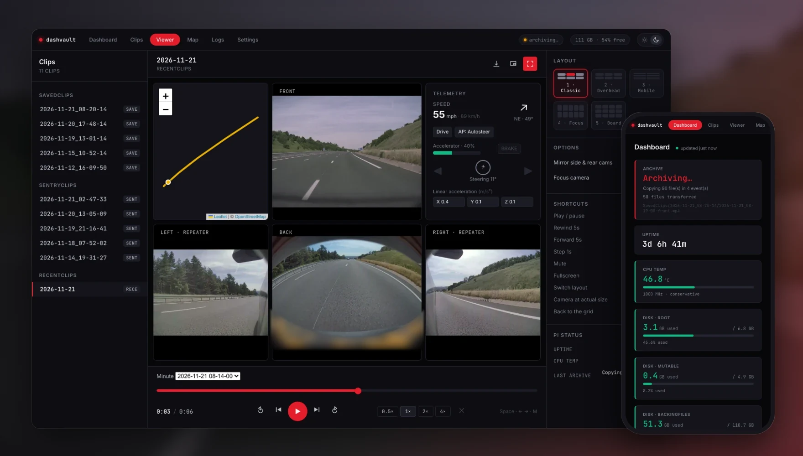
</picture>

<p align="center"><sub>Real screenshots of the web app. The road footage is a sample clip; the status, clip names, map tracks and telemetry are demo data.</sub></p>

The car sees an ordinary USB drive. Behind it is a small computer that joins your home Wi-Fi and, whenever it can reach your NAS or cloud storage, backs up new dashcam and Sentry clips and reclaims the space. You never pull a drive out of the glovebox.

Dashvault is built on [teslausb](https://github.com/marcone/teslausb), which has done the USB drive emulation and archiving since 2018. It adds phone setup over a hotspot or Bluetooth, a new web app, a two-way Telegram bot, a searchable drive log, and tools for looking after the microSD card. See [Credits](#credits).

> [!IMPORTANT]
> Dashvault is a hobby project with no warranty. It is not made, endorsed or supported by Tesla. Read [Before you install](#before-you-install) first.

## What you get

### Flash a card, finish on your phone

No config files and no SSH. Flash the image, join the Pi's setup hotspot or connect over Bluetooth, and choose your Wi-Fi, your login and where clips go. If you mistype the Wi-Fi password, the Pi comes back and tells you. Step-by-step guides: [hotspot](docs/setup-wifi-hotspot.md) or [Bluetooth](docs/setup-bluetooth.md).

<p align="center">
  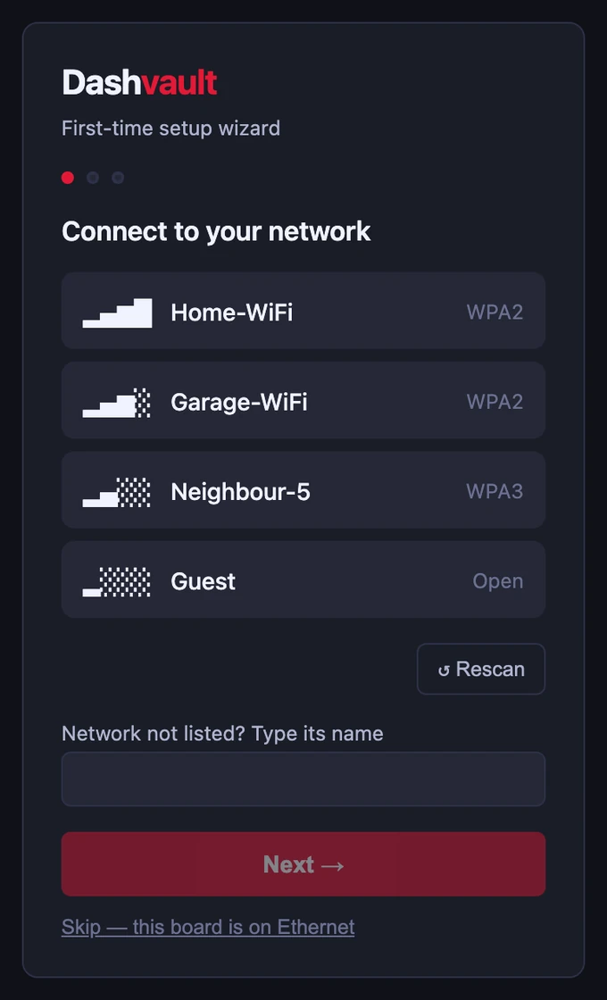
  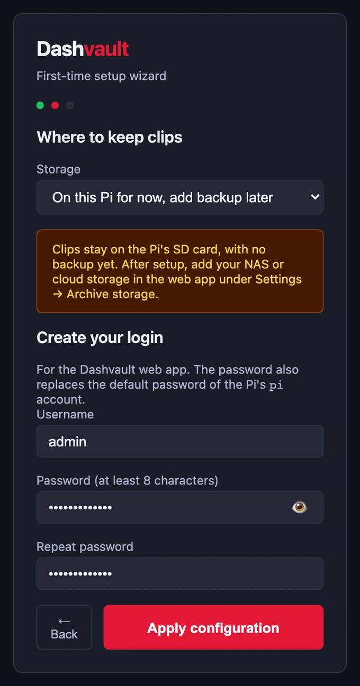
  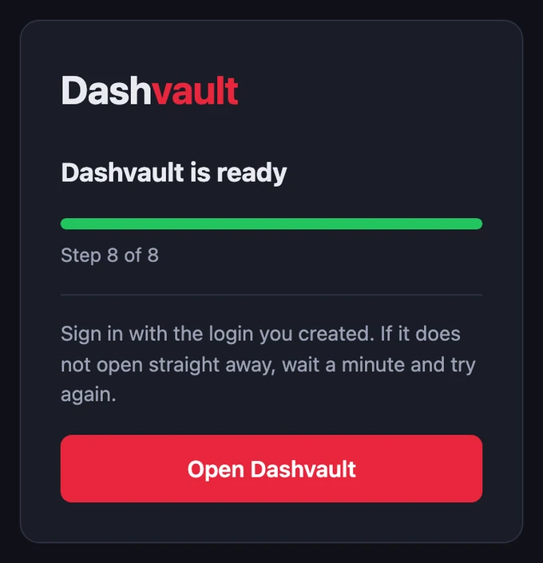
</p>

### Your clips, off the car and on your storage

- When the Pi can reach your archive, it backs up the clips you saved first, then Sentry, Track Mode and any RecentClips you've enabled. If you drive off mid-copy, your saved events are already safe.
- Back up to a Windows/Samba share, an NFS export, an rsync server or any [rclone](https://rclone.org) remote.
- Snapshots extend your local driving history as space allows. Turn on RecentClips backup to copy just the cameras you choose.
- At startup, Dashvault checks the USB drive images and attempts filesystem repairs.
- Advanced setup can add separate USB drives for music, light shows and Boombox sounds on the same card. Set their sizes in the setup file.

<picture>
  <source media="(prefers-color-scheme: dark)" srcset="docs/images/readme/archive-dark.webp">
  <source media="(prefers-color-scheme: light)" srcset="docs/images/readme/archive-light.webp">
  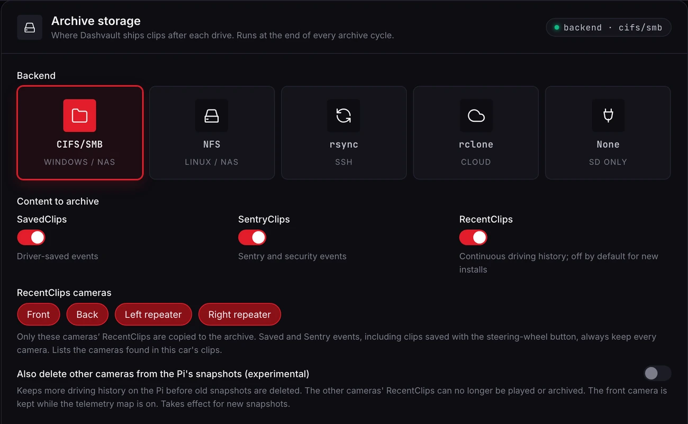
</picture>

### Four cameras, in sync

Play front, rear and side-repeater footage together across five layouts. Click a camera to enlarge it, or drag the dot along the route to seek when the clip has a GPS track.

<picture>
  <source media="(prefers-color-scheme: dark)" srcset="docs/images/readme/viewer-dark.webp">
  <source media="(prefers-color-scheme: light)" srcset="docs/images/readme/viewer-light.webp">
  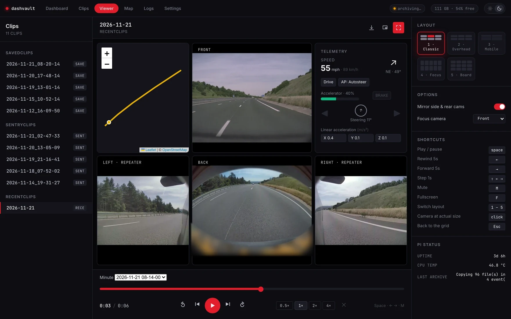
</picture>

### Find footage by where you drove

An optional drive log, off by default. Turn it on in Settings and Dashvault reads the GPS and vehicle data embedded in your front-camera Saved and Recent clips.

- **Look around:** click a spot on the map to see when you drove past it, and jump to that moment in any video still on the Pi.
- Keep your trip history after the videos have been archived or overwritten, for 30 days by default.
- Replay recorded GPS and telemetry at up to 60×. Newer recordings add heading, gear, Autopilot state, accelerator, brake, steering and indicators alongside speed.
- The log is stored on the Pi. It updates during archive cycles. Without an archive, also turn on the experimental **Index while driving**.

<picture>
  <source media="(prefers-color-scheme: dark)" srcset="docs/images/readme/replay-dark.webp">
  <source media="(prefers-color-scheme: light)" srcset="docs/images/readme/replay-light.webp">
  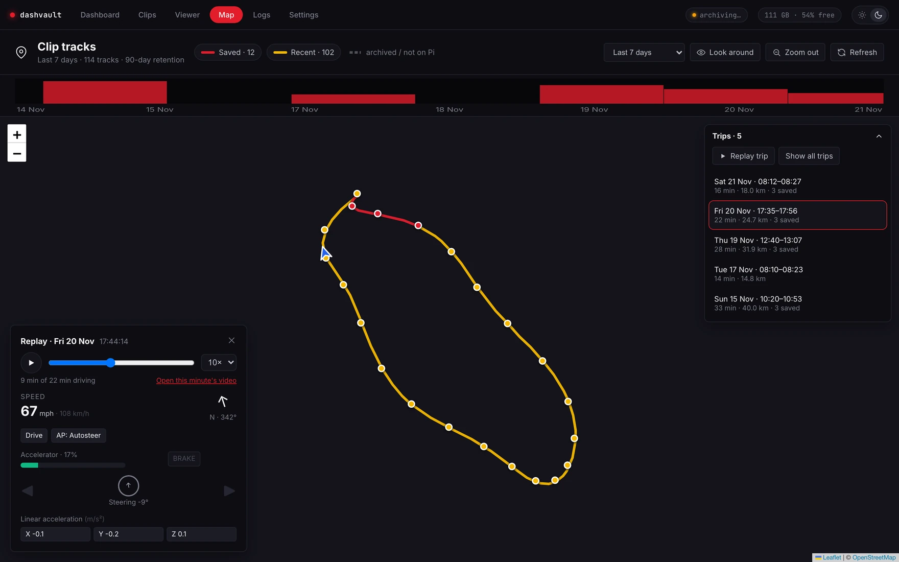
</picture>

### Check on it from your phone

Check archive status, storage, Wi-Fi signal, temperature and power from your phone, with file progress when the archive backend provides it. The dashboard, clip list and map fit a phone. The multi-camera player and Settings are laid out for a larger screen.

<picture>
  <source media="(prefers-color-scheme: dark)" srcset="docs/images/readme/phones-dark.webp">
  <source media="(prefers-color-scheme: light)" srcset="docs/images/readme/phones-light.webp">
  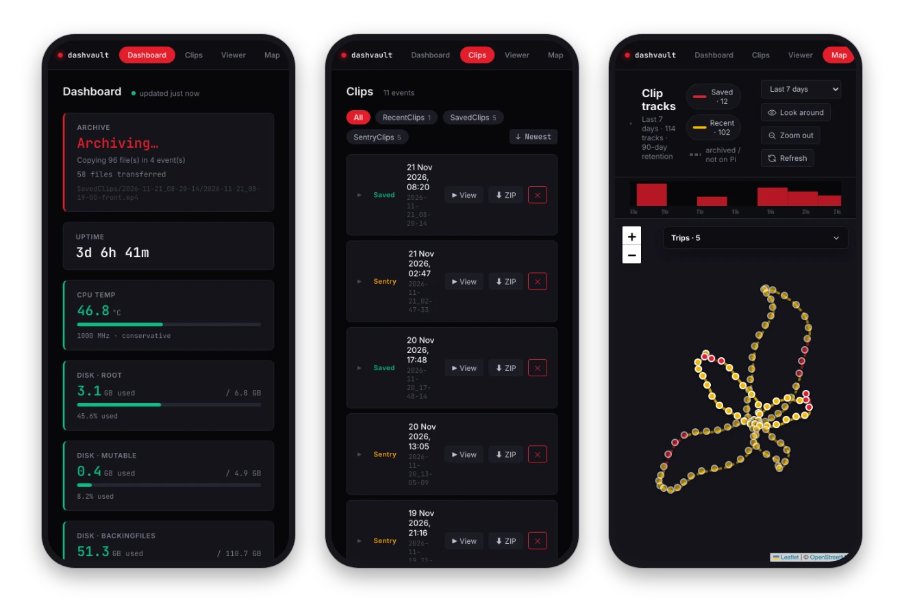
</picture>

### Telegram, card care and updates

- **Two-way Telegram bot.** Optional. Get a message when clips start and finish archiving, ask for status, free space or card statistics, request a sync, or have it send up to five recent Saved or Sentry videos still on the Pi.
- **microSD care.** A short write-speed check, a running total of data the Pi has written to the card, and a warning at a total you set.
- **Power and heat.** Temperature and CPU clock history, with optional power profiles and thermal throttling.
- **Updates.** Optional in-app updates with rollback, and a safe command for operating system updates. See [Updates](#updates).

<table>
  <tr>
    <td width="50%">
      <picture>
        <source media="(prefers-color-scheme: dark)" srcset="docs/images/readme/sdcard-dark.webp">
        <source media="(prefers-color-scheme: light)" srcset="docs/images/readme/sdcard-light.webp">
        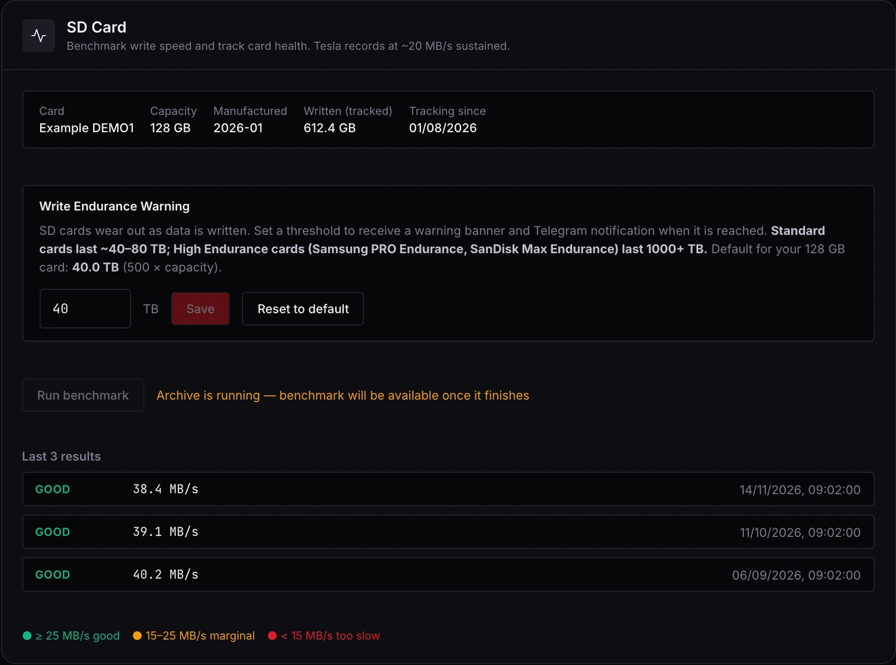
      </picture>
    </td>
    <td width="50%">
      <picture>
        <source media="(prefers-color-scheme: dark)" srcset="docs/images/readme/thermal-dark.webp">
        <source media="(prefers-color-scheme: light)" srcset="docs/images/readme/thermal-light.webp">
        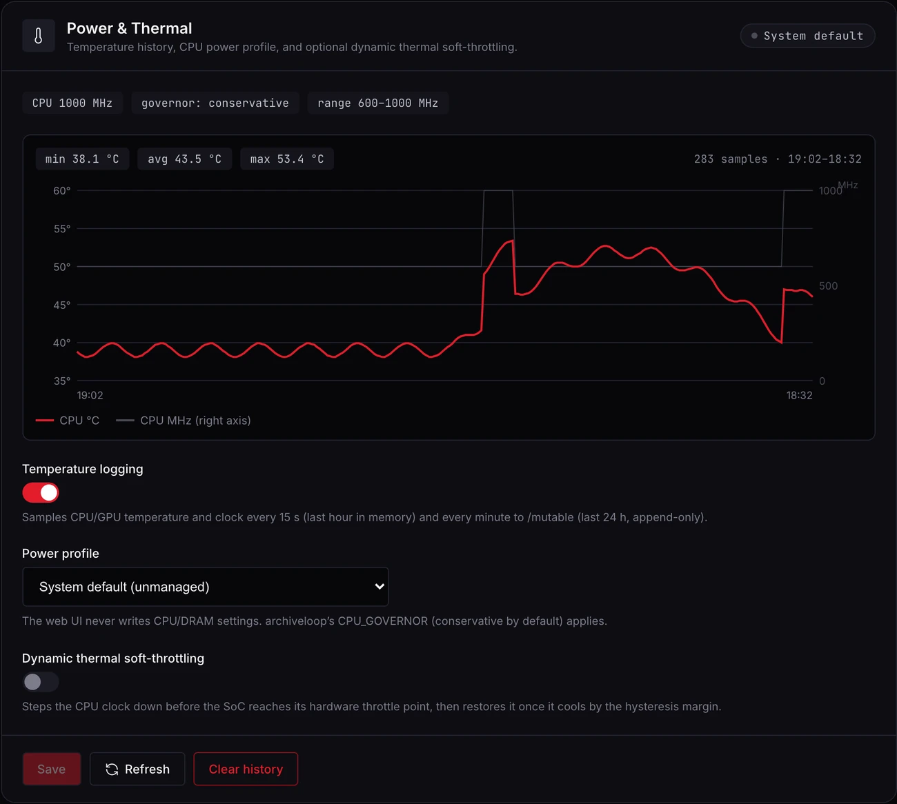
      </picture>
    </td>
  </tr>
</table>

<details>
<summary><strong>More screens</strong></summary>
<br>

**Dashboard**

<picture>
  <source media="(prefers-color-scheme: dark)" srcset="docs/images/readme/dashboard-dark.webp">
  <source media="(prefers-color-scheme: light)" srcset="docs/images/readme/dashboard-light.webp">
  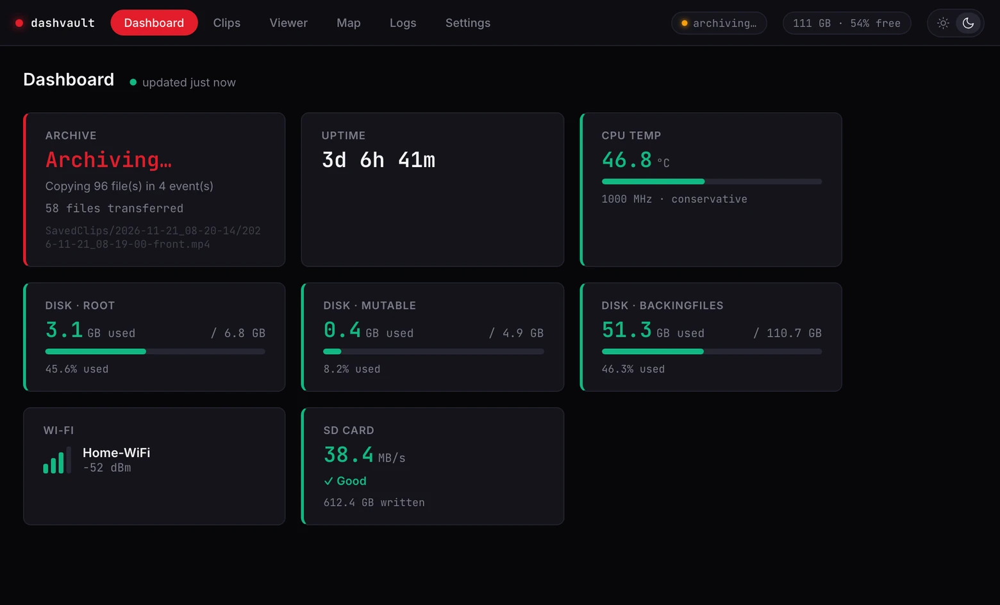
</picture>

**Clip browser**

<picture>
  <source media="(prefers-color-scheme: dark)" srcset="docs/images/readme/clips-dark.webp">
  <source media="(prefers-color-scheme: light)" srcset="docs/images/readme/clips-light.webp">
  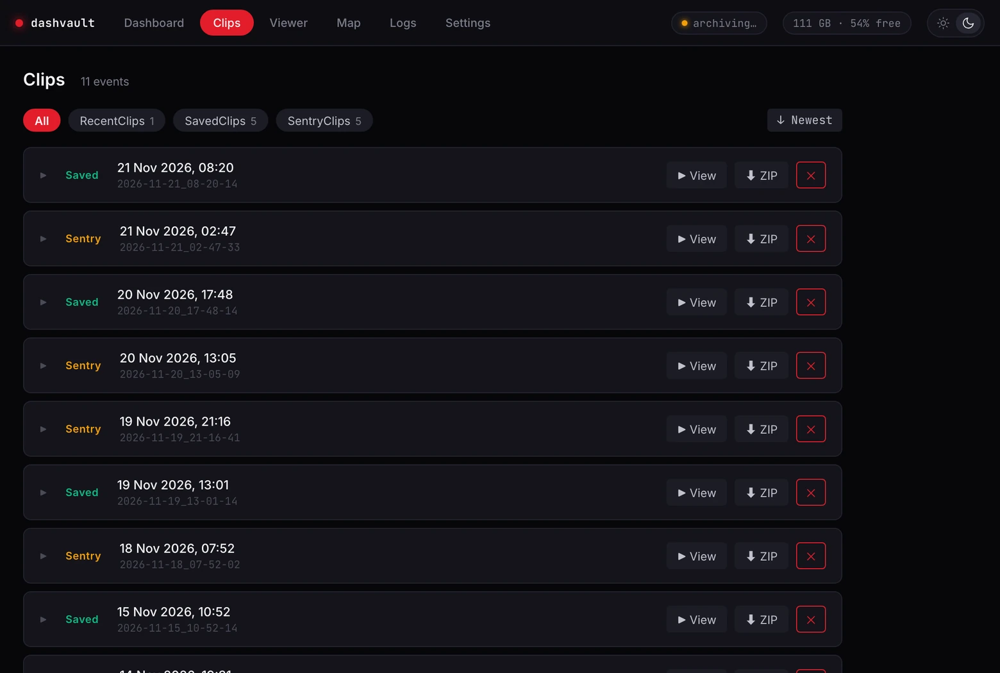
</picture>

**Retained trips on the map**

<picture>
  <source media="(prefers-color-scheme: dark)" srcset="docs/images/readme/map-dark.webp">
  <source media="(prefers-color-scheme: light)" srcset="docs/images/readme/map-light.webp">
  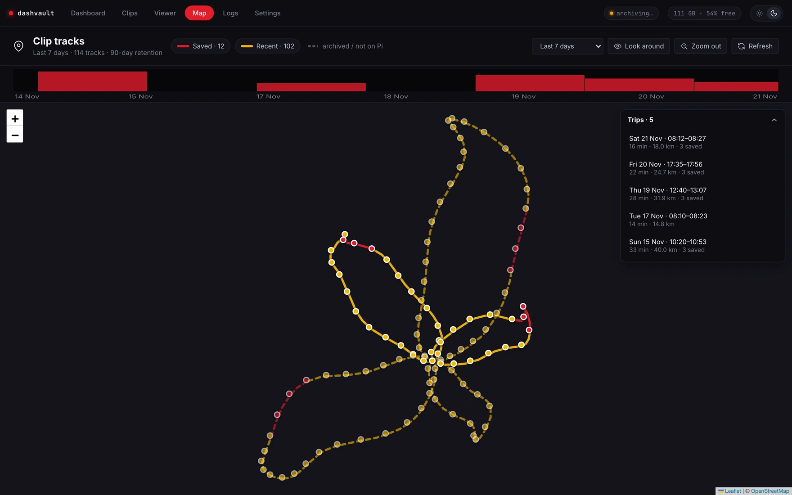
</picture>

**Live logs**

<picture>
  <source media="(prefers-color-scheme: dark)" srcset="docs/images/readme/logs-dark.webp">
  <source media="(prefers-color-scheme: light)" srcset="docs/images/readme/logs-light.webp">
  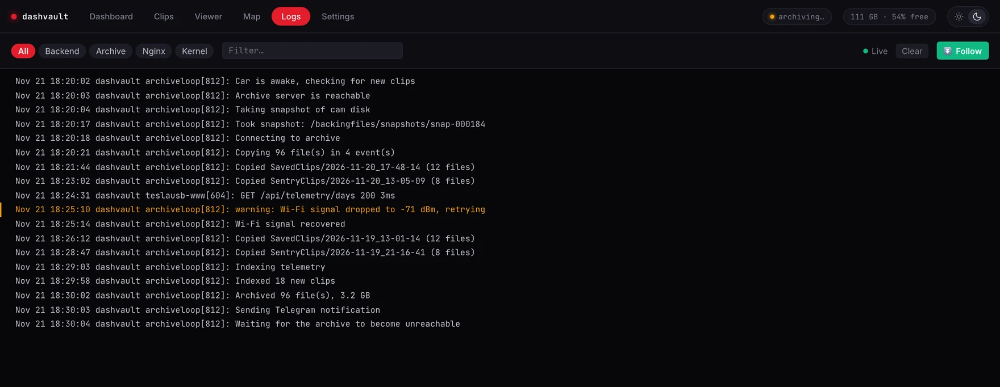
</picture>

</details>

Some features are marked experimental in Settings and are off by default.

## How it works

<picture>
  <source media="(prefers-color-scheme: dark)" srcset="docs/images/readme/how-it-works-dark.svg">
  <source media="(prefers-color-scheme: light)" srcset="docs/images/readme/how-it-works-light.svg">
  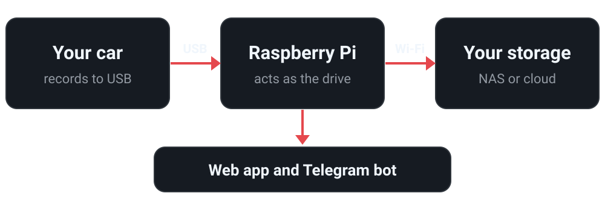
</picture>

1. **On the road,** the car records to the Pi as if it were a USB drive.
2. **When your archive is in reach,** the Pi copies new clips to it from a snapshot, so the car can keep recording.
3. **Afterwards,** local space is reclaimed as needed, which can briefly disconnect the USB drive. The web app browses footage still on the Pi. Older copies live on your archive.

## Hardware

| Board | Status |
|---|---|
| Raspberry Pi Zero 2 W | The recommended board for speed. Not yet tested on the current image, and [an open upstream issue](https://github.com/raspberrypi/linux/issues/7634) affects mixed WPA2/WPA3 routers. |
| Raspberry Pi Zero W | Image, hotspot and Bluetooth setup, and install tested on the current image. The web app and archiving are slow. |
| Radxa Zero 3 | Works with the [install script](#radxa-and-other-boards). No flashable image and no hotspot setup. |
| Raspberry Pi 400 | Image, hotspot and Bluetooth setup, and install tested. USB connection to a car not tested, and as a keyboard computer it is not a practical choice. Does not join WPA3-only networks. |
| Raspberry Pi 4 and 5 | Have board-specific code inherited from teslausb. Not tested with this release. |

You also need:

- A high-endurance microSD card, **128 GB or larger**. Tesla asks for a drive of at least 64 GB, and the Pi keeps part of the card for itself: a 64 GB card gave the car about 43 GB in our test.
- A USB **data** cable from the board's data port to the car. Charge-only cables do not work.
- Home Wi-Fi that reaches where you park. The Pi Zero W only supports 2.4 GHz.
- A router using WPA2 or mixed WPA2/WPA3. On our tested image, the Pi Zero W and Pi 400 failed to join WPA3-only networks, and the Pi Zero W also failed on routers offering PSK-SHA256. See the [measured results](docs/hardware-testing.md#measured-results).
- **Dashcam encryption turned off in the car.** With Encrypt Dashcam Recordings on, Tesla writes to an `EncryptedClips` folder, which Dashvault does not archive or play.
- Optionally, somewhere to archive to: a NAS, a computer with a shared folder, or cloud storage through rclone. Without one, clips stay on the Pi and the oldest age out as space is needed.

## Install

Write the image to a microSD card, power on the Pi, and set it up from your phone or computer. The image carries the Dashvault release it was built from. First boot still needs internet access for package setup.

| Set up over | Works from | Guide |
|---|---|---|
| **Wi-Fi hotspot** | Any phone or laptop, including iPhone | [Illustrated hotspot guide](docs/setup-wifi-hotspot.md) |
| **Bluetooth** | Chrome or Edge on Android, Windows, macOS or Linux. Not iPhone or Safari. | [Illustrated Bluetooth guide](docs/setup-bluetooth.md), or [open the setup page](https://pgodlews.github.io/dashvault/setup/) |
| **Configuration file** | Any computer that can read the card | [Below](#set-up-with-a-file), and the [setup guide](doc/OneStepSetup.md) |

The short version, over the hotspot:

1. Download the image from the [latest release](https://github.com/pgodlews/dashvault/releases/latest) and write it to the microSD card with [Raspberry Pi Imager](https://www.raspberrypi.com/software/) (choose **Use custom** at the bottom of the operating system list, and say no if it offers to apply customisation settings).
2. Put the card in the Pi and power it from a USB charger. After a few minutes a Wi-Fi network called `Dashvault-XXXX` appears. On Pi Zero boards it follows a 90-second Bluetooth window.
3. Join it from your phone or laptop. The setup page usually opens by itself; if it doesn't, go to `http://192.168.4.1`. Choose your Wi-Fi and a login, then keep clips on the Pi for now or enter an SMB or NFS share. You can add an archive later under Settings → Archive storage. Cloud storage needs an rclone remote configured on the Pi over SSH first, and rsync needs the Pi's key authorised on the destination.
4. The Pi restarts, joins your Wi-Fi and installs itself. This takes several minutes, and longer on a Pi Zero W. If it can't join your network, the setup hotspot comes back so you can correct the details.
5. Back on your home Wi-Fi, open `http://dashvault.local` or the Pi's IP address and follow the install until it says Dashvault is ready, then sign in with the login you chose.
6. Plug the Pi into the car's USB data port (the glovebox port on recent cars) and check that the dashcam icon appears on the screen.

> [!WARNING]
> The setup hotspot is open and unencrypted, and whatever you enter on it, including your Wi-Fi password, travels in the clear. The Bluetooth link needs no pairing, so it has the same exposure. Anyone nearby could also reach setup before you do. Do this at home, and finish it promptly.

### Set up with a file

Before the first boot, open the card's `bootfs` partition, copy `teslausb_setup_variables.conf.sample` to `teslausb_setup_variables.conf` and fill it in. With that file present the Pi skips hotspot and Bluetooth setup and joins your Wi-Fi directly. The settings most people need are:

```bash
export SSID='your wifi name'
export WIFIPASS='your wifi password'

export ARCHIVE_SYSTEM=cifs
export ARCHIVE_SERVER=nas.local
export SHARE_NAME='TeslaCam'
export SHARE_USER=dashcam
export SHARE_PASSWORD='share password'

export WEBUI_USERNAME='admin'
export WEBUI_PASSWORD='a long password'
export PI_PASSWORD='another long password'
```

The Pi's name on your network is `dashvault`; set `TESLAUSB_HOSTNAME` to change it. The configuration file, its settings and the paths on the Pi keep the `teslausb` name on purpose, so teslausb guides and tools still apply. The [setup guide](doc/OneStepSetup.md) covers quoting rules for passwords, the LED codes during setup, and troubleshooting.

### Radxa and other boards

For experienced users. There is no Dashvault image and no hotspot or Bluetooth setup for these boards.

**Why:** a ready-to-flash image would have to include the board's Wi-Fi firmware, and we could not confirm that we are allowed to redistribute it. So Dashvault only ships its own code, and you get the operating system and firmware from the vendor.

1. Flash the vendor's Debian image (or Armbian) to a card of at least 64 GB, and get the board onto your network with SSH working.
2. Change the default passwords. Radxa's images create `radxa` and `rock` accounts with well-known passwords.
3. Download and run the install script. It downloads and verifies a release bundle when it needs one:

   ```bash
   curl -fsSL -o install.sh https://raw.githubusercontent.com/pgodlews/dashvault/main/setup/generic/install.sh
   ```

   ```bash
   sudo bash install.sh
   ```

4. It may shrink the root filesystem and reboot, then carry on by itself. When it has finished, open a root shell with `sudo -i`, edit `/teslausb/teslausb_setup_variables.conf`, and run `/etc/rc.local`.

### The web password is required

A fresh unattended install stops near the end if `WEBUI_USERNAME` and `WEBUI_PASSWORD` are missing, and does not finish until they are set. Hotspot and Bluetooth setup always set them. The [setup guide](doc/OneStepSetup.md#security) explains how to recover. The web app can read and delete your footage and change the Pi's configuration, so it is never served without a password.

### Change the login password

The image's `pi` user starts with the well-known password `raspberry`. Setup over the hotspot or Bluetooth replaces it with the password you choose. With a configuration file, set `PI_PASSWORD`. For key-only SSH, also add your key with `SSH_ROOT_PUBLIC_KEY` and set `SSH_DISABLE_PASSWORD_AUTHENTICATION=true`.

## Notifications

Telegram is the only built-in notification channel. The Pushover, Gotify, IFTTT, Discord, Slack, Matrix, Signal, ntfy, AWS SNS and webhook options of teslausb were removed, and their settings no longer send anything. To [set it up](doc/ConfigureNotificationsForArchive.md), create a bot in Telegram, then enter its token and your chat ID in Settings.

## Updates

**Dashvault itself** can update from Settings once you turn it on. It is off by default. Add these to the setup file, and Settings can then install updates and restore the most recent app backup:

```bash
export OTA_ENABLED=true
export OTA_RELEASE_URL=https://api.github.com/repos/pgodlews/dashvault/releases/latest
```

**The operating system** (Debian and Raspberry Pi OS packages, including security fixes) is updated with a command over SSH, because the Pi's system partition is normally read-only and a plain `apt-get upgrade` fails or gets undone:

```bash
sudo /root/bin/os-update.sh check
```

```bash
sudo /root/bin/os-update.sh apply
```

`check` refreshes temporary package lists and reports what is pending, without installing anything. `apply` makes the system writable, installs the updates without asking questions, keeps Dashvault's settings, and normally reboots. If the Pi still boots after a power cut, it attempts to repair the update, and you may need to run `apply` again.

Run `apply` while the Pi has steady power, for example plugged into a charger or with the car awake at home. Losing power while the kernel is being replaced can leave the card unable to boot, and then it has to be flashed again. Your clips on the archive are not affected.

## Before you install

**No warranty.** Dashvault is provided as is, under the [MIT licence](LICENSE), with no warranty of any kind. You use it at your own risk. The authors are not liable for lost footage, damaged hardware, a drained battery, or anything else that follows from using it.

**Not affiliated with Tesla.** This is an independent project. Tesla does not make, endorse or support it. Tesla is a trademark of Tesla, Inc. A software update to the car can change how the dashcam behaves and break this without notice.

**Do not rely on it as your only record.** Footage can be lost: a worn or slow card, a power cut while writing, a full disk, a failed archive, or a bug. If a recording matters, for an insurance claim or the police, save it in the car and copy it somewhere safe yourself as soon as you can. Check now and then that the dashcam icon in the car shows it is recording.

**microSD cards wear out.** A dashcam writes all the time. Use a high-endurance card, watch the write total in the web app, and expect to replace the card.

**Heat.** A parked car can get hot enough to throttle a small computer. Use a case that sheds heat, and keep the board out of direct sun.

**Keep it on your home network.** The web app is protected by a single password over plain HTTP, so credentials and footage are not encrypted in transit. Ten wrong passwords from one address within 60 seconds trigger a five-minute lockout. It is meant for your own network. Do not forward a port to it or expose it to the internet. Use a VPN if you want access from outside.

**Recording other people.** Dashcam and Sentry footage shows other people and their number plates. Laws on recording, keeping and sharing it differ from country to country. Following them is your responsibility.

**What leaves the Pi.** Clips go to the archive you configure and to devices you download them on. The map loads tiles from a map server, OpenStreetMap's unless you change it in Settings, so that server sees which areas you view. Opening Street View shares that spot with Google. Telegram messages, and any videos or stills you request or configure it to attach, pass through Telegram's servers.

**Your credentials are on the card.** The configuration file holds your Wi-Fi password and archive credentials in readable form. If the Pi is stolen, change them.

## Documentation

- Setup, step by step: [over the Wi-Fi hotspot](docs/setup-wifi-hotspot.md) or [over Bluetooth](docs/setup-bluetooth.md)
- [Setup guide](doc/OneStepSetup.md) for configuration files, LED codes and troubleshooting
- Archive targets: [Windows/Samba share](doc/SetupShare.md), [rsync](doc/SetupRSync.md), [rclone](doc/SetupRClone.md)
- [Telegram notifications and bot](doc/ConfigureNotificationsForArchive.md)
- [External drive on a Pi 4](doc/Pi4ExternalDriveSetup.md)
- [Backing up and restoring the Pi's configuration](docs/pi-backup-restore.md)
- [How RecentClips are kept](docs/snapshots.md)
- [Testing a microSD card](docs/sd-card-write-testing.md) and [power use by board](docs/power-benchmarking.md)
- [Architecture](docs/architecture.md) and the [developer documentation index](docs/index.md)

## Developing

You do not need a Pi to work on Dashvault. A Docker harness runs the scripts against a fake Pi and a Samba server.

```bash
git clone https://github.com/pgodlews/dashvault.git
cd dashvault
just bootstrap        # Python tooling and pre-commit hooks
just ci               # lint, tests, UI build and the integration harness
```

You need Docker, [just](https://github.com/casey/just), [uv](https://github.com/astral-sh/uv), Go 1.22 or later, Node 20.19 or later with pnpm, [Gitleaks](https://github.com/gitleaks/gitleaks), and Playwright Chromium. [CONTRIBUTING.md](CONTRIBUTING.md) has the conventions.

| Part | Technology | Location |
|---|---|---|
| Archive loop and USB gadget | Bash | `run/` |
| Telegram bot | Python 3, standard library only | `run/teslausb_telegram_bot.py` |
| API | Go | `teslausb-www/go-backend/` |
| Web app | React, Vite, Tailwind | `teslausb-www/new/` |
| Device setup | Bash and Python | `setup/`, `run/provisioning/` |
| SD image | pi-gen | `pi-gen-sources/` |

## Credits

Dashvault exists because teslausb does. The idea came from a [2018 r/teslamotors thread](https://www.reddit.com/r/teslamotors/comments/9m9gyk/build_a_smart_usb_drive_for_your_tesla_dash_cam/). **cimryan** published the first scripts, and **[marcone](https://github.com/marcone/teslausb)** has maintained and extended teslausb for years since, with many contributors. The USB drive emulation, snapshots, archive loop and device setup in this repository are their work.

If you want the original project, with its wider range of notification services and its own web interface, use [marcone/teslausb](https://github.com/marcone/teslausb).

## Licence

[MIT](LICENSE), the same as teslausb.
