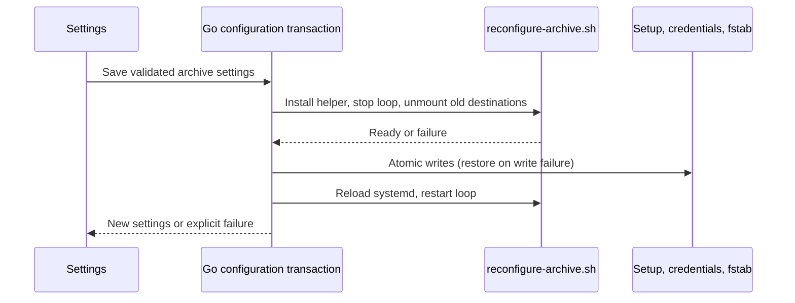
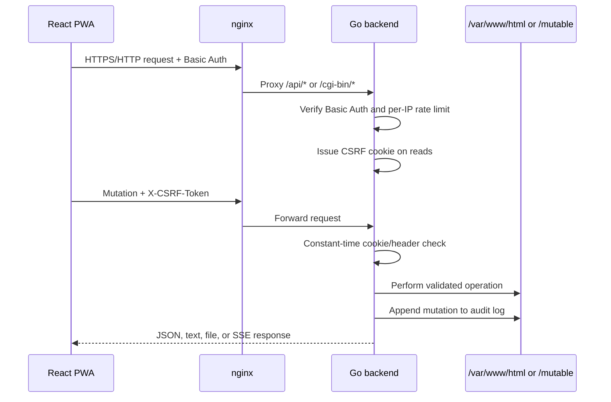

# Architecture Overview

Reference for developers and AI agents. Start here, then use the component guides in the [documentation index](index.md).

## System Context

TeslaUSB runs on Raspberry Pi and other USB-OTG-capable SBCs. It presents a backing image to the car as USB mass storage, archives recordings when a configured archive is reachable, and serves a local web interface and Telegram controls.

```mermaid
flowchart LR
    Car[Tesla vehicle] <-->|USB mass storage| Gadget[Pi USB gadget]
    Gadget --> CamImage[cam_disk.bin and snapshots]
    CamImage --> ArchiveLoop[archiveloop]

    Browser[Browser] -->|HTTP Basic Auth| Nginx[nginx]
    Nginx --> UI[React PWA in /new/]
    Nginx --> API[Go backend on 127.0.0.1:8080]
    Nginx --> Playback[cttseraser MP4 playback]

    Telegram[Telegram service] <--> Bot[Telegram bot]
    Bot --> API
    Bot --> Sentinel[/tmp/archive_is_unreachable]

    API --> Status[System, disk, Wi-Fi and archive state]
    API --> Tracks[Local telemetry store]
    ArchiveLoop --> Tracks
    ArchiveLoop --> Sentinel
    ArchiveLoop -->|CIFS, NFS, rsync, or other configured backend| NAS[Archive storage]

    UI -->|Telemetry JSON| API
    UI -->|Raster tiles or vector style| Maps[OSM or trusted local map server]
```

## Pi Components

| Component | Implementation | Responsibility |
|---|---|---|
| USB gadget layer | configfs scripts and backing images | Present camera/music storage to the Tesla; detach it for maintenance |
| `teslausb.service` | `run/archiveloop` | Coordinate snapshots, mounts, telemetry indexing, archiving, free space, and notifications |
| `teslausb-backend` | Go, socket-activated | Authenticated HTTP APIs, file operations, settings, status/log streams, telemetry, OTA, and SD-card tools |
| nginx | `teslausb-www/teslausb.nginx` | Basic Auth, static PWA, MP4 access, and proxying to the Go backend |
| React PWA | `teslausb-www/new/` | Dashboard, clips, viewer, Saved/Recent maps, logs, and settings |
| `cttseraser` | C++ FUSE layer | Remove the Tesla `ctts` atom during browser playback |
| Telegram bot | `run/teslausb_telegram_bot.py` | Authorized status, SD-card, archive, clip, and restart commands |
| Notification dispatcher | `run/send-push-message` | Archive and system notifications through enabled providers |

The Go backend owns HTTP behavior. Hardware and archive orchestration remain in shell because they directly manage mounts, USB gadgets, snapshots, and filesystem repair.

## Storage Layout

| Path | Purpose |
|---|---|
| `/backingfiles/cam_disk.bin` | Persistent FAT image presented to the car |
| `/backingfiles/snapshots/` | Snapshot images used for atomic USB swaps |
| `/mutable/TeslaCam/` | Current clip tree visible to the Pi |
| `/mutable/telemetry/days/<YYYY-MM-DD>.json` | Telemetry clip metadata for one local day (replaces the old single `clips.json`, migrated on first use) |
| `/mutable/telemetry/days/<day>.<gen>.f32`, `.line` | A finished day's tracks packed into one file, and its simplified map lines |
| `/mutable/telemetry/tracks/` | Raw Float32 track blobs, keyed by clip-ID hash, until their day is packed |
| `/mutable/sdcard_*.json` | Benchmark history and write/endurance statistics |
| `/mutable/audit.log` | Backend mutation audit trail |
| `/run/teslausb/archive_state` | Volatile current archive state |
| `/var/www/html/new/` | Built React application |
| `/var/www/html/TeslaCam/` | `cttseraser` playback view |
| `/root/teslausb_setup_variables.conf` | Main Pi configuration; never commit its contents |

## First-Run Provisioning

A distinctive part of the fork is its headless onboarding: a BLE GATT peripheral, a temporary open Wi-Fi captive portal, and an authenticated browser setup wizard. Pi Zero W/2W devices try BLE before falling back to the AP; other supported Pi models can run BLE and the AP concurrently. Successful provisioning writes a sentinel and starts normal configuration.

The captive portal is the self-contained browser path. The BLE peripheral requires an external compatible client because no Web Bluetooth client is currently shipped. See [`provisioning.md`](provisioning.md) for the Mermaid state flow, security boundary, and fresh-install validation status.

## Archive and Telemetry Flow

Archiving normally happens when Wi-Fi and the selected archive backend are reachable. Saved and Sentry archiving default to enabled; Recent archiving defaults to disabled and is configurable. TrackMode is controlled separately.

When telemetry maps are enabled, eligible SavedClips and RecentClips are indexed **after** the archive copy (so a backlog never delays it), from the links in `/mutable/TeslaCam`. SentryClips are not indexed. Extraction failure does not block archiving. One `telemetry_index.py index-batch --scan` run per cycle lists the clips itself: clips already indexed are skipped after a stat, clips older than the retention are not read, only new clips are extracted, and the archive's reachability is re-checked at most once a minute. Then `compact` packs each finished day into one file (drive log step 2).

With the experimental `TELEMETRY_WHILE_DRIVING`, the same indexing also runs in the background after every snapshot, also while driving, at the lowest CPU and I/O priority, with a time budget of half the snapshot interval.

```mermaid
sequenceDiagram
    participant Car as Tesla
    participant Loop as archiveloop
    participant Cam as Camera snapshot/overlay
    participant Index as telemetry_index.py
    participant Store as /mutable/telemetry
    participant NAS as Archive backend

    Car->>Loop: Clips present on camera backing image
    Loop->>Loop: Detect reachable archive or manual sync sentinel
    Loop->>Car: Temporarily detach USB camera drive
    Loop->>Cam: Mount/repair image and build snapshot overlay
    Loop->>NAS: Copy enabled categories (Saved, Sentry, TrackMode, Recent)
    Loop->>Index: index-batch --scan /mutable/TeslaCam
    Index->>Index: Read front-camera MP4 SEI metadata of new clips
    Index->>Store: Write raw track and the day's clip metadata
    Note over Index,Store: Filename timestamps drive display and retention.<br/>MP4 PTS is used only for playback alignment.
    Loop->>Index: mark-listed, then compact finished days
    Index->>Store: One packed track file and map line file per day
    Loop->>Loop: Update archive state and send notifications
    Loop->>Car: Reconnect USB camera drive
```

Archive settings changes hold the rootfs configuration lock, install the selected mount helper if missing, stop the archive loop, and normally unmount the old archive/music destinations. Busy mounts block the save. The backend atomically updates only the archive fstab entries, credentials, and setup keys before reloading systemd and restarting the loop. Write failures restore the prior files and leave archiving stopped; restart failures are reported with the intended destination saved.



See [`shell-layer.md`](shell-layer.md) for the loop and [`new-ui.md`](new-ui.md) for map/viewer behavior.

## Telemetry Storage and Playback

`run/telemetry_index.py` reads SEI metadata directly from front-camera MP4 files without decoding video. It downsamples tracks to approximately 1 Hz and stores either legacy four-value or extended 15-value little-endian Float32 points.

Extended points contain playback time, position, speed, heading, gear, Autopilot state, three-axis acceleration, accelerator position, brake state, steering angle, and blinkers. The viewer interpolates these values against the front camera's playback timestamp.

Track history survives clip archival. The backend marks clips as `available`, `archived`, or `overwritten`; only locally available clips are playable. NAS playback is intentionally outside the current map feature.

Maps use OpenStreetMap raster tiles by default. `TELEMETRY_TILE_URL` selects another raster source, and `TELEMETRY_MAP_STYLE_URL` selects a trusted local or remote MapLibre vector style. The browser contacts the configured map server; GPS tracks themselves remain on the Pi.

## HTTP and Authentication Flow



- nginx and the Go backend both verify the configured credentials.
- Mutations require a matching `teslausb_csrf` cookie and `X-CSRF-Token` header and are audited.
- `/api/status/stream` and `/api/logs/stream` are long-lived SSE endpoints.
- File operations are rooted below the configured document root; telemetry clip IDs and source paths are validated separately.
- Setup preserves unrelated configuration values and uses atomic writes for sensitive configuration updates.

## Manual Sync and Telegram

The UI and Telegram `/sync` touch `/tmp/archive_is_unreachable`. The archive loop treats this sentinel as a request to stop waiting and start a fresh cycle. Telegram `/sdcard` reads card capacity, write statistics, endurance threshold, and benchmark history from the same files used by the web UI.

## OTA Transaction Boundary

Apply and rollback run in named transient systemd oneshot units, independently of the backend control group. The scripts share `/run/teslausb/rootfs.lock` with Go configuration writers, own one root-writable transaction, and restore the original root mount state on success or failure. Backend log appends never wrap or interrupt the independent transaction. OTA enablement and release URL are read from the setup file, with explicit service environment overrides. Releases carry the Telegram unit as well as its script; apply and rollback back up/restore the effective unit, reload systemd, and restart the bot only if it was active, preserving enablement. For older installers that only copy `bin/`, backend startup invokes a compatibility finalizer after the installer releases the rootfs lock; it extends the same backup before updating the effective Telegram unit.

## SD-Card Testing

Two complementary strategies are documented in [`sd-card-write-testing.md`](sd-card-write-testing.md):

1. `tools/sustained-write-test.py` reproduces four 36 MiB camera clips per minute with paced writes and one-minute file rotation.
2. `run/benchmark.sh` measures conservative durable-block writes on the Pi; a separate 1 GiB direct-I/O procedure measures longer sequential throughput on a Linux host.

The benchmark uses `/dev/zero` to avoid distorting Pi results with random-data CPU generation.

## Extension Points

- **Notification channels:** add a `send_<name>()` function and enable gate in `run/send-push-message`. See [`extending/add-notifier.md`](extending/add-notifier.md).
- **Archive backends:** implement the fixed script interface under `run/<name>_archive/` and register it during setup. See [`extending/add-archive-backend.md`](extending/add-archive-backend.md).
- **Backend routes:** add the handler and tests, then register it with `read()` or `mutate()` in `main.go`.
- **UI routes:** add a file-based TanStack route and regenerate the route tree through the normal build.

## File Quick Reference

| Area | Path |
|---|---|
| Archive loop | `run/archiveloop` |
| Telemetry extraction | `run/telemetry_index.py` |
| Notifications and Telegram | `run/send-push-message`, `run/teslausb_telegram_bot.py` |
| SD-card benchmark | `run/benchmark.sh` |
| Tesla-like write helper | `tools/sustained-write-test.py` |
| Shell paths | `run/lib/paths.sh` |
| Pi setup | `setup/pi/configure.sh` |
| Web/backend setup | `setup/pi/configure-web.sh` |
| Go backend | `teslausb-www/go-backend/` |
| React source | `teslausb-www/new/src/` |
| Python tests | `tests/python/` |
| Docker integration harness | `tests/harness/` |
| Development commands | `Justfile` |

## Repositories and Environments

| Remote | Role |
|---|---|
| `origin` (`github.com/pgodlews/dashvault`) | Public repository and release host |
| `upstream` (`github.com/marcone/teslausb`) | The project Dashvault is based on. The histories are separate |

The trunk is **`main`**. Use topic branches and Conventional Commits. Never run CI or destructive tests against the live Pi. SD-card write tests require an explicitly selected mounted target and must not race active recording or archiving.
