# Power & Throughput Benchmarking (USB Port Budget Analysis)

> [!NOTE]
> **BLE Power Meter Protocol & Telemetry Attribution**  
> The Bluetooth Low Energy (`RFstar` UART GATT `0xffe4` / `0xffe9`, CRC-16/XMODEM framing, and 10 Hz V/A/W/D+/D−/temperature packet decoder) used by `tools/power-benchmark.py` is built on **[pgodlews/fnirsi-fnb58-web-monitor](https://github.com/pgodlews/fnirsi-fnb58-web-monitor)** — a browser-based Web Bluetooth & WebUSB real-time monitor for FNIRSI FNB58 / FNB48 / FNB38 USB power meters.

When a TeslaUSB single-board computer (SBC) is plugged into a Tesla's dashcam USB port, it must stay within the vehicle's USB current and power limits across both operational states:

1. **Driving / Sentry Recording**: Continuous synchronous writes to the backing store (4 camera streams at ~144–160 MiB/min, or ~2.5–2.7 MB/s sustained).
2. **Stationary Archiving**: Outbound Wi-Fi transfers when parked at home while USB power remains active.

---

## 1. Vehicle USB Port Specifications

| USB Standard / Port | Nominal Voltage | Max Current | Max Power | Notes |
| :--- | :---: | :---: | :---: | :--- |
| **USB 2.0 Specification** | 5.0 V | `500 mA` | **2.50 W** | Relevant for older ports or unpowered USB 2.0 splitters/hubs |
| **USB 3.0 Specification** | 5.0 V | `900 mA` | **4.50 W** | Relevant for Tesla glovebox blue USB-A port (2021+ Model 3/Y) |

---

## 2. Automated BLE Power & Throughput Benchmark (`tools/power-benchmark.py`)

`tools/power-benchmark.py` connects to a **FNIRSI FNB58 / FNB48 / FNB38** USB power meter over Bluetooth Low Energy (~10 Hz notification stream, compatible with the [fnirsi-fnb58-web-monitor](https://github.com/pgodlews/fnirsi-fnb58-web-monitor) protocol) and coordinates remote workloads on the target SBC over SSH.

### Prerequisites

Install `bleak` on the host running the Bluetooth LE capture:

```bash
pip install bleak
```

If benchmarking outbound Wi-Fi throughput, start a lightweight TCP discard listener on a LAN host:

```bash
python3 -c '
import socket
s = socket.socket(socket.AF_INET, socket.SOCK_STREAM)
s.setsockopt(socket.SOL_SOCKET, socket.SO_REUSEADDR, 1)
s.bind(("0.0.0.0", 19999))
s.listen(5)
while True:
    conn, _ = s.accept()
    while conn.recv(262144): pass
    conn.close()
'
```

### Running the Full Power-Mode Matrix

```bash
python3 tools/power-benchmark.py \
  --ssh-target pi@dashvault.local \
  --wifi-sink-host <lan-sink-host> \
  --wifi-sink-port 19999 \
  --runs 3 \
  --output-dir ./power_benchmark_results
```

For standalone BLE power recording without SSH automation:

```bash
python3 tools/power-benchmark.py --record-only --duration 60 --output-dir ./power_trace
```

### What the Script Tests per Power Mode

The script auto-detects the target hardware's power management capabilities (`cpufreq` governors, discrete frequency caps, runtime CPU core hotplugging, RAM/GPU `devfreq` governors, and `iw` Wi-Fi power-save states) and cycles through each mode while recording:

1. **Idle Baseline (`3.5 s`)**: Settled power draw with no active disk or network load.
2. **Synchronous Disk Write Benchmark (`160 MiB × 3 runs`)**: Runs `/root/bin/benchmark.sh` (`40 × 4 MiB` blocks with `oflag=dsync conv=fsync`) and records exact write throughput (`MB/s`) alongside average and peak power (`W` / `mA`).
3. **Outbound Wi-Fi Transfer (`100 MiB × 3 runs`)**: Streams 100 MiB over TCP to the LAN sink (never overlapping with disk writes) and records outbound transfer speed (`MB/s`) alongside average and peak power (`W` / `mA`).

On exit (including `Ctrl+C`), a `trap` restores all CPU cores, frequency limits, default governors, and restarts `teslausb.service`.

---

## 3. Radxa Zero 3 (Rockchip RK3566) Benchmark Results

- **SoC**: Rockchip RK3566 (4× ARM Cortex-A55 @ `408–1800 MHz`, Mali-G52 GPU, LPDDR4 `dmc` @ `324–1056 MHz`)
- **Wi-Fi**: 5 GHz 802.11ax (Wi-Fi 6)
- **Total BLE Samples Captured**: 8,495 samples at ~10.1 Hz across 14 power configurations

### 3.1 Plotted Diagrams

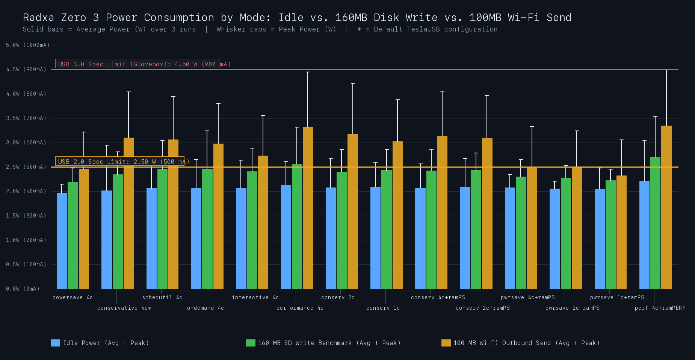

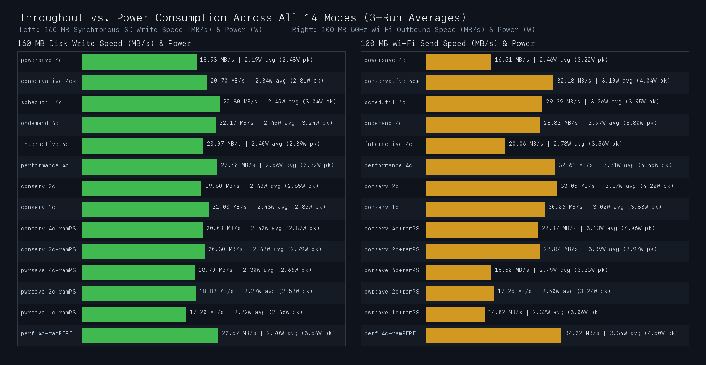

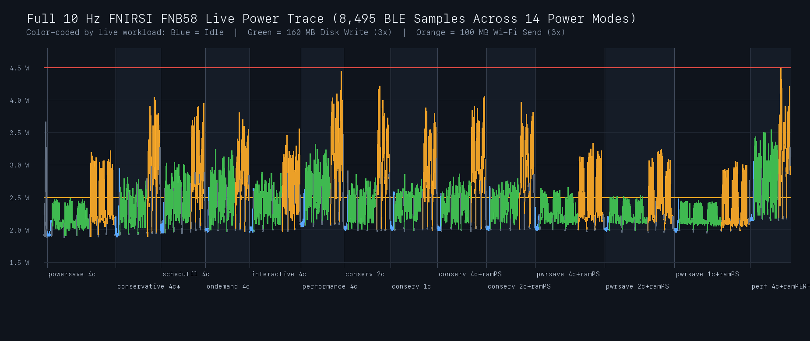

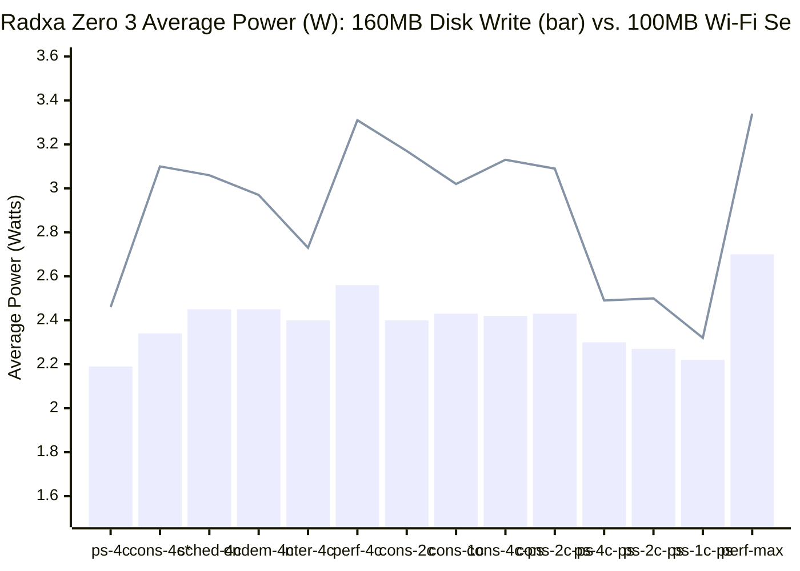

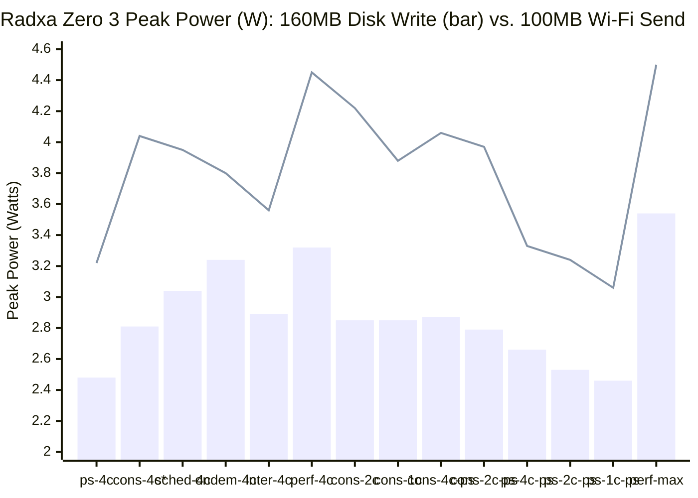

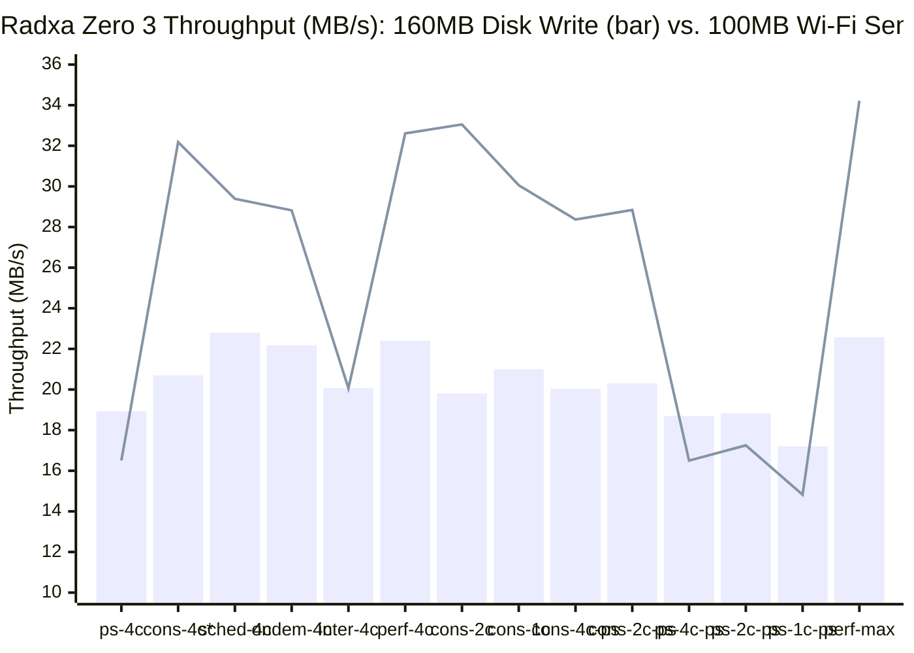

### 3.2 Summary Table (3-Run Averages per Mode)

| # | Power Profile (`mode_id`) | Cores | CPU / RAM Clock (Load) | Idle Avg (`W` / `mA`) | Disk Write Avg (`W` / `mA`) | Disk Write Peak (`W` / `mA`) | Write Speed (`MB/s`) | Wi-Fi Send Avg (`W` / `mA`) | Wi-Fi Send Peak (`W` / `mA`) | Wi-Fi Speed (`MB/s`) | SoC Temp (`°C`) |
| :- | :--- | :---: | :---: | :---: | :---: | :---: | :---: | :---: | :---: | :---: | :---: |
| 1 | **`gov_powersave_4c`**<br>*(powersave, 4c, def RAM/GPU)* | 4 | 408 / 324 MHz | 1.96 W<br>`395 mA` | **2.19 W**<br>`443 mA` | **2.48 W**<br>`503 mA` | **18.93**<br>*(18.3–19.5)* | 2.46 W<br>`498 mA` | 3.22 W<br>`652 mA` | 16.51 | 58.3–60.0 |
| 2 | **`gov_conservative_4c`** *(Default)*<br>*(conservative, 4c, def RAM/GPU)* | 4 | 1800 / 324–780 MHz | 2.01 W<br>`406 mA` | **2.34 W**<br>`475 mA` | **2.81 W**<br>`570 mA` | **20.70**<br>*(20.0–21.7)* | 3.10 W<br>`631 mA` | 4.04 W<br>`824 mA` | **32.18** | 61.7–63.9 |
| 3 | **`gov_schedutil_4c`**<br>*(schedutil, 4c, def RAM/GPU)* | 4 | 1608–1800 / 324–780 MHz | 2.06 W<br>`417 mA` | **2.45 W**<br>`496 mA` | **3.04 W**<br>`619 mA` | **22.80**<br>*(22.2–23.4)* | 3.06 W<br>`622 mA` | 3.95 W<br>`805 mA` | 29.39 | 63.9–65.6 |
| 4 | **`gov_ondemand_4c`**<br>*(ondemand, 4c, def RAM/GPU)* | 4 | 1800 / 324–780 MHz | 2.06 W<br>`417 mA` | 2.45 W<br>`497 mA` | 3.24 W<br>`660 mA` | 22.17<br>*(22.0–22.3)* | 2.97 W<br>`604 mA` | 3.80 W<br>`778 mA` | 28.82 | 64.4–66.2 |
| 5 | **`gov_interactive_4c`**<br>*(interactive, 4c, def RAM/GPU)* | 4 | 1800 / 324–780 MHz | 2.06 W<br>`416 mA` | 2.40 W<br>`487 mA` | 2.89 W<br>`586 mA` | 20.07<br>*(19.7–20.6)* | 2.73 W<br>`553 mA` | 3.56 W<br>`726 mA` | 20.06 | 65.0–65.6 |
| 6 | **`gov_performance_4c`**<br>*(performance, 4c, def RAM/GPU)* | 4 | 1800 / 324–780 MHz | 2.13 W<br>`430 mA` | 2.56 W<br>`519 mA` | 3.32 W<br>`675 mA` | 22.40<br>*(22.3–22.6)* | 3.31 W<br>`675 mA` | 4.45 W<br>`910 mA` | 32.61 | 67.5–68.8 |
| 7 | **`conservative_2c_def`**<br>*(conservative, 2c, def RAM/GPU)* | 2 | 1800 / 324–780 MHz | 2.07 W<br>`419 mA` | 2.40 W<br>`485 mA` | 2.85 W<br>`579 mA` | 19.80<br>*(19.4–20.1)* | 3.17 W<br>`646 mA` | 4.22 W<br>`859 mA` | **33.05** | 67.5–69.4 |
| 8 | **`conservative_1c_def`**<br>*(conservative, 1c, def RAM/GPU)* | 1 | 1800 / 324–780 MHz | 2.09 W<br>`422 mA` | 2.43 W<br>`492 mA` | 2.85 W<br>`580 mA` | 21.00<br>*(20.5–21.7)* | 3.02 W<br>`614 mA` | 3.88 W<br>`787 mA` | 30.06 | 66.9–68.1 |
| 9 | **`conservative_4c_devps`**<br>*(conservative, 4c, powersave RAM/GPU)* | 4 | 1800 / 324 MHz | 2.06 W<br>`417 mA` | 2.42 W<br>`490 mA` | 2.87 W<br>`581 mA` | 20.03<br>*(19.6–20.4)* | 3.13 W<br>`638 mA` | 4.06 W<br>`825 mA` | 28.37 | 66.9–69.4 |
| 10 | **`conservative_2c_devps`**<br>*(conservative, 2c, powersave RAM/GPU)* | 2 | 1800 / 324 MHz | 2.08 W<br>`421 mA` | 2.43 W<br>`492 mA` | **2.79 W**<br>`565 mA` | 20.30<br>*(19.8–21.0)* | 3.09 W<br>`629 mA` | 3.97 W<br>`808 mA` | 28.84 | 67.5–69.4 |
| 11 | **`powersave_4c_devps`**<br>*(powersave, 4c, powersave RAM/GPU)* | 4 | 408 / 324 MHz | 2.07 W<br>`419 mA` | 2.30 W<br>`465 mA` | 2.66 W<br>`538 mA` | 18.70<br>*(18.5–18.9)* | 2.49 W<br>`504 mA` | 3.33 W<br>`675 mA` | 16.50 | 64.4–65.0 |
| 12 | **`powersave_2c_devps`**<br>*(powersave, 2c, powersave RAM/GPU)* | 2 | 408 / 324 MHz | 2.05 W<br>`414 mA` | 2.27 W<br>`459 mA` | 2.53 W<br>`514 mA` | 18.83<br>*(18.6–19.2)* | 2.50 W<br>`508 mA` | 3.24 W<br>`656 mA` | 17.25 | 63.9 |
| 13 | **`powersave_1c_devps`** *(Min Power)*<br>*(powersave, 1c, powersave RAM/GPU)* | 1 | 408 / 324 MHz | 2.04 W<br>`413 mA` | **2.22 W**<br>`449 mA` | **2.46 W**<br>`497 mA` | 17.20<br>*(17.1–17.3)* | **2.32 W**<br>`470 mA` | **3.06 W**<br>`619 mA` | 14.82 | 62.8 |
| 14 | **`performance_4c_devperf`** *(Max Power)*<br>*(performance, 4c, perf RAM/GPU)* | 4 | 1800 / 1056 MHz | 2.20 W<br>`446 mA` | 2.70 W<br>`547 mA` | 3.54 W<br>`722 mA` | 22.57<br>*(22.3–22.8)* | 3.34 W<br>`681 mA` | 4.50 W<br>`916 mA` | **34.22** | 66.2–68.8 |

### 3.3 Key Takeaways (Radxa Zero 3)

1. **Default `conservative` fits inside USB 3.0 (`900 mA / 4.50 W`)**:
   - Synchronous 160 MiB disk writes average **`2.34 W` (`475 mA`)** with peaks of **`2.81 W` (`570 mA`)** at **`20.7 MB/s`**.
   - 5 GHz Wi-Fi 6 outbound transfers average **`3.10 W` (`631 mA`)** with peaks of **`4.04 W` (`824 mA`)** at **`32.2 MB/s`**.
2. **`powersave` (`408 MHz`) fits inside legacy USB 2.0 (`500 mA / 2.50 W`) during recording**:
   - Synchronous 160 MiB disk writes average **`2.19 W` (`443 mA`)** with peaks of **`2.48–2.50 W` (`497–503 mA`)** while still sustaining **`18.9 MB/s`** (more than 7× the ~2.5 MB/s required for 4 cameras).
3. **Frequency/Voltage OPP dominates over core hotplugging**:
   - Because all 4 Cortex-A55 cores share a single cluster voltage rail (`VDD_CPU`), taking cores 1–3 offline while remaining on `conservative` does not reduce power draw (`2.34 W` @ 4c vs `2.40 W` @ 2c), whereas lowering the cluster clock/voltage OPP via `powersave` reduces both power and SoC temperature (`~58 °C` vs `~68 °C`).

---

## 4. Raspberry Pi Zero 2 W (Broadcom BCM2710A1) Benchmark Results

- **SoC**: Broadcom BCM2710A1 / RP3A0-AU SiP (4× ARM Cortex-A53 @ `600–1000 MHz`, VideoCore IV `core` clock coupled @ `250–400 MHz`)
- **Wi-Fi**: 2.4 GHz 802.11n (`brcmfmac` CYW43436)
- **Total BLE Samples Captured**: 7,519 samples at ~10.0 Hz across 12 power configurations

### 4.1 Plotted Diagrams

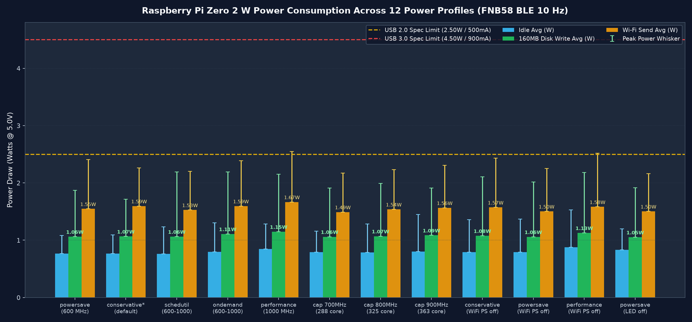

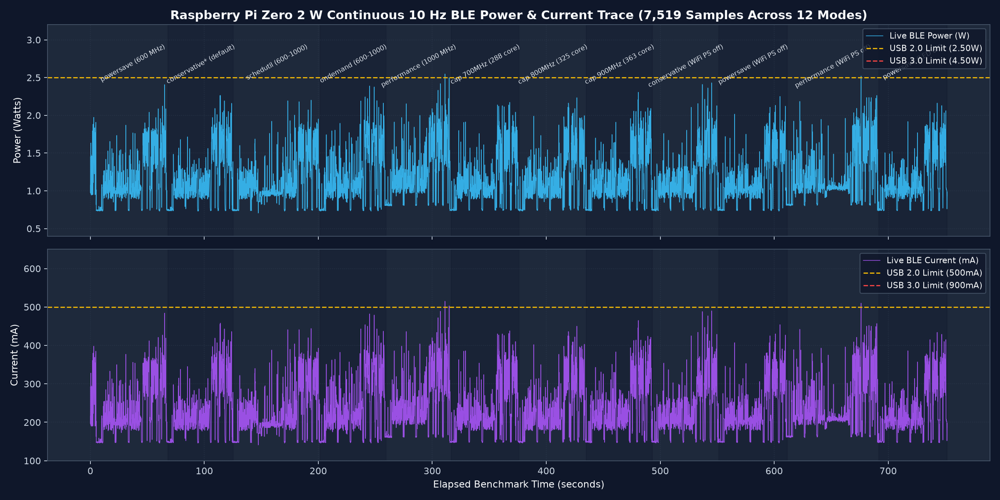

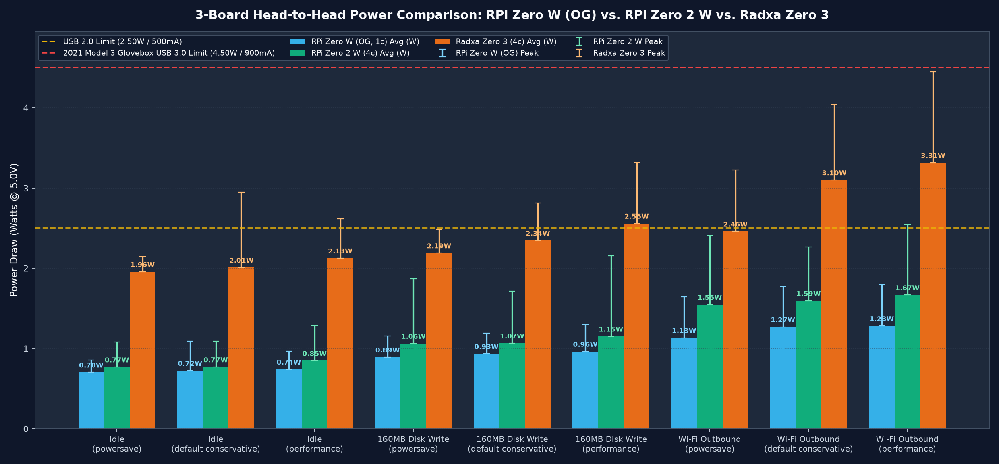

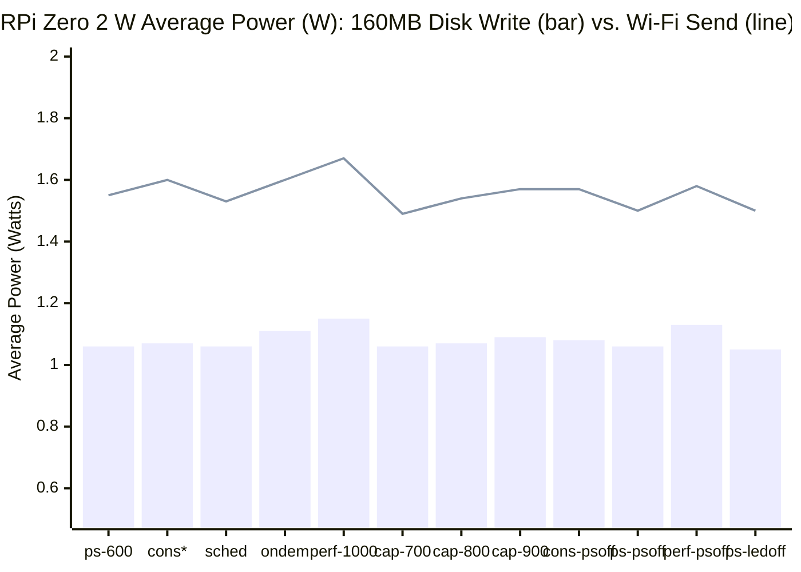

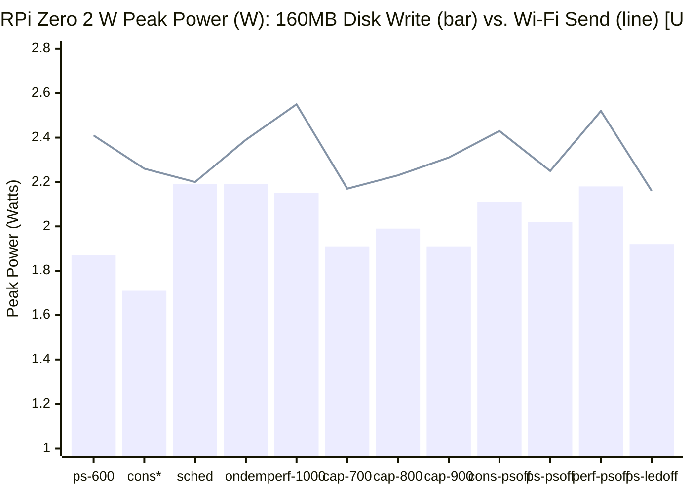

### 4.2 Summary Table (3-Run Averages per Mode)

| # | Power Profile (`mode_id`) | ARM / Core Clock (Load) | Wi-Fi PS | Idle Avg (`W` / `mA`) | Disk Write Avg (`W` / `mA`) | Disk Write Peak (`W` / `mA`) | Write Speed (`MB/s`) | Wi-Fi Send Avg (`W` / `mA`) | Wi-Fi Send Peak (`W` / `mA`) | Wi-Fi Speed (`MB/s`) | SoC Temp (`°C`) |
| :- | :--- | :---: | :---: | :---: | :---: | :---: | :---: | :---: | :---: | :---: | :---: |
| 1 | **`gov_powersave_4c`**<br>*(powersave, 600 MHz)* | 600 / 250 MHz | `on` | **0.77 W**<br>`154 mA` | **1.06 W**<br>`213 mA` | 1.87 W<br>`377 mA` | **17.67**<br>*(17.6–17.8)* | 1.55 W<br>`311 mA` | 2.41 W<br>`484 mA` | 4.58 | 37.6–38.1 |
| 2 | **`gov_conservative_4c`** *(Default)*<br>*(conservative, 600–1000 MHz)* | 1000 / 400 MHz | `on` | **0.77 W**<br>`154 mA` | **1.07 W**<br>`214 mA` | **1.71 W**<br>`345 mA` | **17.70**<br>*(17.6–17.8)* | 1.60 W<br>`321 mA` | 2.26 W<br>`458 mA` | **5.25** | 37.6–38.6 |
| 3 | **`gov_schedutil_4c`**<br>*(schedutil, 600–1000 MHz)* | 900–1000 / 325–363 MHz | `on` | **0.76 W**<br>`153 mA` | 1.06 W<br>`213 mA` | 2.19 W<br>`441 mA` | 17.50*<br>*(5.8–17.6)* | 1.53 W<br>`308 mA` | 2.20 W<br>`444 mA` | 5.22 | 37.6–39.2 |
| 4 | **`gov_ondemand_4c`**<br>*(ondemand, 600–1000 MHz)* | 800–1000 / 363 MHz | `on` | 0.80 W<br>`160 mA` | 1.11 W<br>`222 mA` | 2.19 W<br>`443 mA` | 17.53<br>*(17.5–17.6)* | 1.60 W<br>`321 mA` | 2.39 W<br>`482 mA` | 5.09 | 38.1–39.2 |
| 5 | **`gov_performance_4c`**<br>*(performance, 1000 MHz)* | 1000 / 400 MHz | `on` | 0.85 W<br>`170 mA` | 1.15 W<br>`231 mA` | 2.15 W<br>`436 mA` | **17.80**<br>*(17.7–17.9)* | 1.67 W<br>`336 mA` | 2.55 W<br>`515 mA` | 5.19 | 38.6–39.2 |
| 6 | **`cap_700mhz_conservative`**<br>*(conservative, cap 700 MHz)* | 700 / 287.5 MHz | `on` | 0.79 W<br>`158 mA` | **1.06 W**<br>`212 mA` | 1.91 W<br>`386 mA` | 17.47<br>*(17.4–17.5)* | **1.49 W**<br>`300 mA` | **2.17 W**<br>`438 mA` | 5.00 | 38.6–39.2 |
| 7 | **`cap_800mhz_conservative`**<br>*(conservative, cap 800 MHz)* | 800 / 325 MHz | `on` | 0.79 W<br>`157 mA` | 1.07 W<br>`214 mA` | 1.99 W<br>`402 mA` | 17.53<br>*(17.5–17.6)* | 1.54 W<br>`310 mA` | 2.23 W<br>`450 mA` | 5.13 | 39.2 |
| 8 | **`cap_900mhz_conservative`**<br>*(conservative, cap 900 MHz)* | 900 / 362.5 MHz | `on` | 0.80 W<br>`160 mA` | 1.09 W<br>`218 mA` | 1.91 W<br>`383 mA` | 17.53<br>*(17.5–17.6)* | 1.57 W<br>`315 mA` | 2.31 W<br>`465 mA` | 5.18 | 38.6–39.7 |
| 9 | **`conservative_wifipsoff`**<br>*(conservative, Wi-Fi PS off)* | 1000 / 400 MHz | `off` | 0.79 W<br>`158 mA` | 1.08 W<br>`216 mA` | 2.11 W<br>`425 mA` | 17.43<br>*(17.4–17.5)* | 1.57 W<br>`317 mA` | 2.43 W<br>`490 mA` | 5.22 | 39.2–39.7 |
| 10 | **`powersave_wifipsoff`**<br>*(powersave, Wi-Fi PS off)* | 600 / 250 MHz | `off` | 0.79 W<br>`159 mA` | 1.06 W<br>`212 mA` | 2.02 W<br>`407 mA` | 17.53<br>*(17.4–17.6)* | 1.50 W<br>`303 mA` | 2.25 W<br>`454 mA` | 5.12 | 39.2–39.7 |
| 11 | **`performance_wifipsoff`** *(Max Power)*<br>*(performance, Wi-Fi PS off)* | 1000 / 400 MHz | `off` | 0.88 W<br>`175 mA` | 1.13 W<br>`226 mA` | 2.18 W<br>`442 mA` | 17.80*<br>*(5.7–17.8)* | 1.58 W<br>`319 mA` | 2.52 W<br>`510 mA` | 4.59 | 39.2–40.8 |
| 12 | **`powersave_led_off`** *(Min Power)*<br>*(600 MHz, Wi-Fi PS on, LED off)* | 600 / 250 MHz | `on` | 0.83 W<br>`167 mA` | **1.05 W**<br>`211 mA` | 1.92 W<br>`386 mA` | 17.53<br>*(17.4–17.6)* | 1.50 W<br>`303 mA` | **2.16 W**<br>`434 mA` | 4.91 | 39.7–40.2 |

*\*Note: 2 of the 36 disk write runs across the 12 modes encountered a brief internal SD card flash garbage-collection pause (`5.7–5.8 MB/s`), while the remaining 34 runs all completed at `17.4–17.9 MB/s`.*

### 4.3 Key Takeaways (Raspberry Pi Zero 2 W)

1. **Fits inside USB 2.0 (`500 mA / 2.50 W`) across all modes during SD card writes**:
   - Even at `performance` (`1000 MHz` ARM / `400 MHz` VideoCore), 160 MiB synchronous SD card writes average **`1.05–1.15 W` (`211–231 mA`)** with peaks of **`1.71–2.19 W` (`345–443 mA`)** — leaving **`>300 mW` (`>57 mA`)** of headroom below the strict **USB 2.0 (`2.50 W / 500 mA`)** limit and **`>2.3 W` (`>450 mA`)** of headroom below **USB 3.0 (`4.50 W / 900 mA`)**.
2. **Zero write-speed penalty at `600 MHz` (`powersave`)**:
   - Because `/root/bin/benchmark.sh` streams from `/dev/zero`, synchronous SD card write speed on the RPi Zero 2 W is bound by the SDHCI bus (`~17.5–17.8 MB/s`), not CPU clock. Running at **`600 MHz` (`powersave`)** achieves **`17.67 MB/s`** (`1.06 W` avg) vs **`17.70–17.80 MB/s`** at `1000 MHz` (`1.07–1.15 W` avg).
3. **Cool thermal profile**:
   - Across 12 consecutive modes (36 × 160 MiB disk writes + 36 Wi-Fi transfers), the RPi Zero 2 W SoC remained between **`37.6 °C` and `40.8 °C`** (compared to `58.3–69.4 °C` on the Radxa Zero 3).

---

## 5. Raspberry Pi Zero W (OG, Broadcom BCM2835) Benchmark Results

- **SoC**: Broadcom BCM2835 (1× ARM1176JZF-S `armv6l` @ `700–1000 MHz`, VideoCore IV `core` clock coupled @ `250–400 MHz`)
- **Wi-Fi**: 2.4 GHz 802.11n (`brcmfmac` CYW43438)
- **Total BLE Samples Captured**: 8,299 samples at ~10.0 Hz across 10 power configurations

### 5.1 Plotted Diagrams

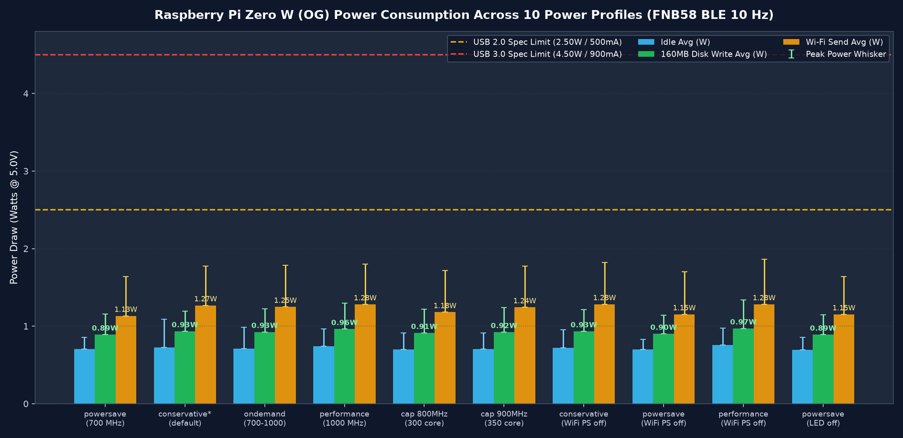

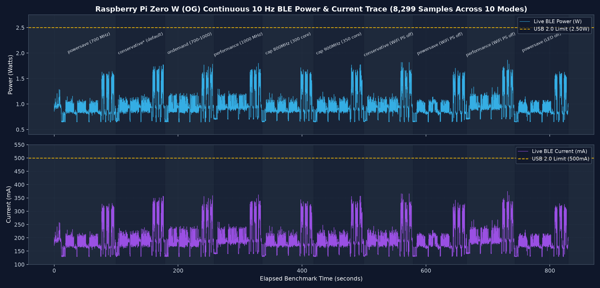

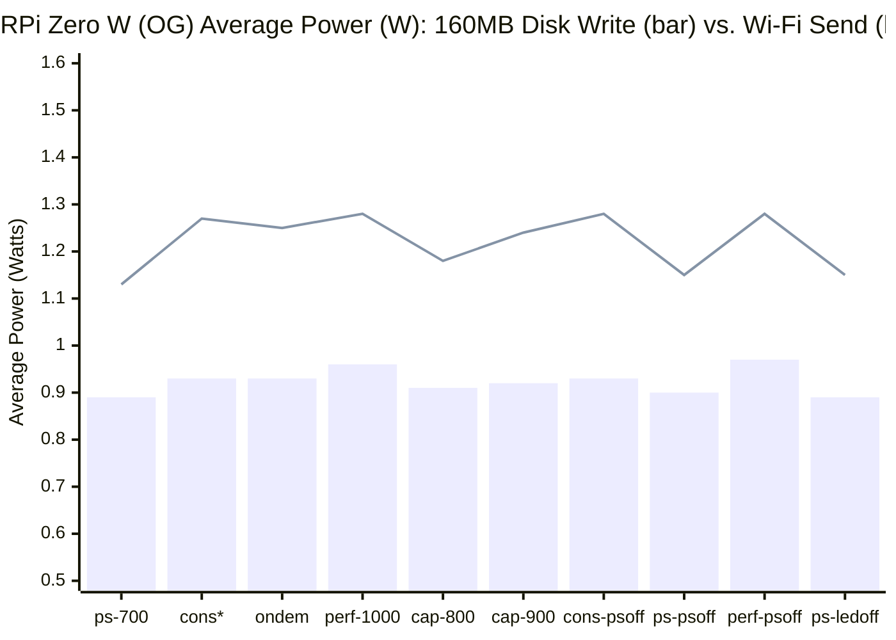

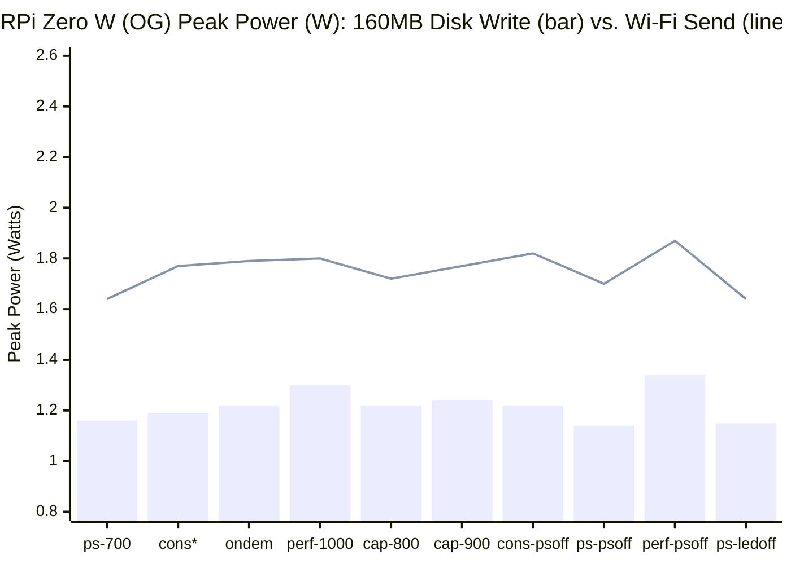

### 5.2 Summary Table (3-Run Averages per Mode)

| # | Power Profile (`mode_id`) | ARM / Core Clock (Load) | Wi-Fi PS | Idle Avg (`W` / `mA`) | Disk Write Avg (`W` / `mA`) | Disk Write Peak (`W` / `mA`) | Write Speed (`MB/s`) | Wi-Fi Send Avg (`W` / `mA`) | Wi-Fi Send Peak (`W` / `mA`) | Wi-Fi Speed (`MB/s`) | SoC Temp (`°C`) |
| :- | :--- | :---: | :---: | :---: | :---: | :---: | :---: | :---: | :---: | :---: | :---: |
| 1 | **`gov_powersave_1c`**<br>*(powersave, 700 MHz)* | 700 / 250 MHz | `on` | **0.70 W**<br>`140 mA` | **0.89 W**<br>`178 mA` | 1.16 W<br>`232 mA` | 11.40<br>*(11.3–11.5)* | **1.13 W**<br>`227 mA` | 1.64 W<br>`330 mA` | 4.65 | 36.9–37.4 |
| 2 | **`gov_conservative_1c`** *(Default)*<br>*(conservative, 700–1000 MHz)* | 1000 / 400 MHz | `on` | 0.73 W<br>`145 mA` | 0.93 W<br>`187 mA` | 1.19 W<br>`239 mA` | 11.63<br>*(11.6–11.7)* | 1.27 W<br>`255 mA` | 1.77 W<br>`357 mA` | 4.99 | 36.9–39.0 |
| 3 | **`gov_ondemand_1c`**<br>*(ondemand, 700–1000 MHz)* | 1000 / 400 MHz | `on` | 0.71 W<br>`142 mA` | 0.93 W<br>`185 mA` | 1.22 W<br>`245 mA` | 11.57<br>*(11.4–11.7)* | 1.25 W<br>`251 mA` | 1.79 W<br>`359 mA` | 4.97 | 37.9–39.0 |
| 4 | **`gov_performance_1c`**<br>*(performance, 1000 MHz)* | 1000 / 400 MHz | `on` | 0.74 W<br>`148 mA` | 0.96 W<br>`193 mA` | 1.30 W<br>`260 mA` | **12.03**<br>*(12.0–12.1)* | 1.28 W<br>`258 mA` | 1.80 W<br>`362 mA` | 4.96 | 39.0–40.1 |
| 5 | **`cap_800mhz_conservative`**<br>*(conservative, cap 800 MHz)* | 800 / 300 MHz | `on` | **0.70 W**<br>`140 mA` | 0.91 W<br>`183 mA` | 1.22 W<br>`245 mA` | 11.50<br>*(11.5)* | 1.18 W<br>`237 mA` | 1.72 W<br>`344 mA` | **5.00** | 38.5–39.5 |
| 6 | **`cap_900mhz_conservative`**<br>*(conservative, cap 900 MHz)* | 900 / 350 MHz | `on` | 0.71 W<br>`141 mA` | 0.92 W<br>`185 mA` | 1.24 W<br>`248 mA` | 11.63<br>*(11.6–11.7)* | 1.24 W<br>`250 mA` | 1.77 W<br>`357 mA` | 4.94 | 38.5–40.1 |
| 7 | **`conservative_wifipsoff`**<br>*(conservative, Wi-Fi PS off)* | 1000 / 400 MHz | `off` | 0.72 W<br>`144 mA` | 0.93 W<br>`187 mA` | 1.22 W<br>`244 mA` | 11.63<br>*(11.6–11.7)* | 1.28 W<br>`258 mA` | 1.82 W<br>`366 mA` | 4.96 | 39.0–40.1 |
| 8 | **`powersave_wifipsoff`**<br>*(powersave, Wi-Fi PS off)* | 700 / 250 MHz | `off` | **0.70 W**<br>`140 mA` | 0.90 W<br>`180 mA` | **1.14 W**<br>`229 mA` | 11.37<br>*(11.1–11.5)* | 1.15 W<br>`231 mA` | 1.70 W<br>`342 mA` | 4.92 | 38.5–39.0 |
| 9 | **`performance_wifipsoff`** *(Max Power)*<br>*(performance, Wi-Fi PS off)* | 1000 / 400 MHz | `off` | 0.76 W<br>`151 mA` | 0.97 W<br>`194 mA` | 1.34 W<br>`268 mA` | **12.00**<br>*(11.9–12.1)* | 1.28 W<br>`258 mA` | 1.87 W<br>`375 mA` | **5.08** | 39.5–41.2 |
| 10 | **`powersave_led_off`** *(Min Power)*<br>*(700 MHz, Wi-Fi PS on, LED off)* | 700 / 250 MHz | `on` | **0.70 W**<br>`139 mA` | **0.89 W**<br>`178 mA` | 1.15 W<br>`230 mA` | 11.40<br>*(11.3–11.5)* | 1.15 W<br>`231 mA` | **1.64 W**<br>`329 mA` | 4.89 | 39.0–39.5 |

---

## 6. 3-Board Platform Power, Thermal & Throughput Comparison

| Metric / Capability | Radxa Zero 3 (Rockchip RK3566) | Raspberry Pi Zero 2 W (BCM2710A1) | Raspberry Pi Zero W OG (BCM2835) |
| :--- | :--- | :--- | :--- |
| **CPU Cores & Architecture** | 4× Cortex-A55 (`aarch64`) | 4× Cortex-A53 (`armv7l` / `aarch64`) | 1× ARM1176JZF-S (`armv6l`) |
| **Available `cpufreq` Steps** | 7 steps: `408`–`1800 MHz` | 5 steps: `600`, `700`, `800`, `900`, `1000 MHz` | 4 steps: `700`, `800`, `900`, `1000 MHz` |
| **Bus / Memory Clock Scaling** | Independent `devfreq` (`dmc` `324–1056 MHz`, GPU `200–600 MHz`) | Coupled VideoCore `core` clock (`250–400 MHz`) | Coupled VideoCore `core` clock (`250–400 MHz`) |
| **Thermal Sensors & Cutoffs** | `soc-thermal` + `gpu-thermal` (`75 °C` + `85 °C` passive / `115 °C` crit) | `cpu-thermal` (`80 °C` soft / `85 °C` hard / `110 °C` crit) | `cpu-thermal` (`80 °C` soft / `85 °C` hard / `110 °C` crit) |
| **Idle Power (`conservative`)** | **`2.01 W`** (`406 mA`) | **`0.77 W`** (`154 mA`) | **`0.73 W`** (`145 mA`) |
| **160 MiB Disk Write Power (`conservative`)** | **`2.34 W` avg / `2.81 W` peak** (`475 / 570 mA`) | **`1.07 W` avg / `1.71 W` peak** (`214 / 345 mA`) | **`0.93 W` avg / `1.19 W` peak** (`187 / 239 mA`) |
| **160 MiB Disk Write Throughput (`conservative`)** | **`20.70 MB/s`** *(up to `22.80 MB/s`)* | **`17.70 MB/s`** *(up to `17.80 MB/s`)* | **`11.63 MB/s`** *(up to `12.03 MB/s`)* |
| **Outbound Wi-Fi Power (`conservative`)** | **`3.10 W` avg / `4.04 W` peak** (`631 / 824 mA`) | **`1.60 W` avg / `2.26 W` peak** (`321 / 458 mA`) | **`1.27 W` avg / `1.77 W` peak** (`255 / 357 mA`) |
| **Outbound Wi-Fi Throughput (`conservative`)** | **`32.18 MB/s`** *(5 GHz Wi-Fi 6)* | **`5.25 MB/s`** *(2.4 GHz 802.11n)* | **`4.99 MB/s`** *(2.4 GHz 802.11n)* |
| **USB 2.0 (`500 mA / 2.50 W`) Compliance** | Requires `powersave` (`408 MHz`) for disk writes (`2.48 W` peak) | **Passes in all modes** for disk writes (`≤2.19 W` peak) & default Wi-Fi | **Passes in all modes with >25% margin** (`≤1.87 W` absolute max peak) |
| **2021 Model 3 Glovebox USB 3.0 (`900 mA / 4.50 W`)** | **Passes** in default `conservative` (`2.81 W` write / `4.04 W` Wi-Fi peak) | **Passes in all modes with >43% margin** (`≤2.55 W` absolute max peak) | **Passes in all modes with >58% margin** (`≤1.87 W` absolute max peak) |
| **Operating SoC Temperature** | `58.3 °C – 69.4 °C` | `37.6 °C – 40.8 °C` | `36.9 °C – 41.2 °C` |

---

## 7. Applying the Results: Web UI Power Profiles & Thermal Soft-Throttling

The findings above are exposed in **Settings → Power & Thermal** (see [`go-backend.md`](go-backend.md#power--thermal-api)):

- **Temperature logging** is on by default and plots the last 24 h of SoC temperature and CPU clock.
- **Power profile** defaults to *System default* (no sysfs writes). Boards that are tight on USB budget (e.g. RK3566 on a USB 2.0 port) can select `powersave`, or `auto` to save power while recording and boost only while archiving.
- **Dynamic thermal soft-throttling** is off by default. When enabled it steps the clock down at 68 °C and to the minimum at 75 °C (configurable), well before the hardware limits listed in section 6.
