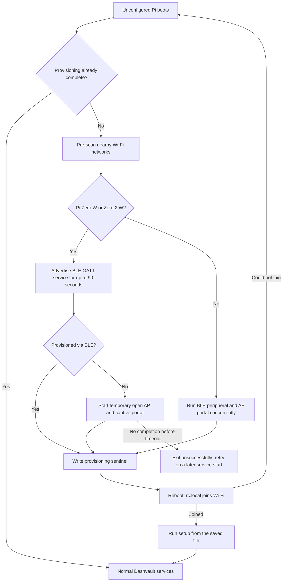

# First-Run Provisioning

Dashvault includes a provisioning system designed for a headless Pi installed without a keyboard, monitor, or manually edited SD-card configuration. It combines three paths:

- A **BLE GATT peripheral** for nearby Wi-Fi/archive provisioning.
- A **temporary open Wi-Fi access point and captive portal** for browser setup.
- The authenticated **web setup wizard**, which applies configuration and streams setup progress.

The captive portal is the self-contained path. The same page, `run/provisioning/portal.html`, also works as a Web Bluetooth client when it is opened from a secure origin (HTTPS or `localhost`) in Chrome or Edge. It needs hosting for that, which is not set up yet. Safari and iOS have no Web Bluetooth, so iPhones use the hotspot.

All paths only produce `/root/teslausb_setup_variables.conf`. The Pi then reboots and runs the same setup as a configuration file placed on the card by hand.

## Supported Boards

Provisioning runs only on the Raspberry Pi image. Other boards, such as the Radxa Zero 3W, use `setup/generic/install.sh` on the vendor's own image with a configuration file. A Dashvault image for them would have to redistribute the vendor's Wi-Fi firmware (AIC8800 on the Radxa), whose redistribution terms we could not confirm, so none is published. Their users are expected to be comfortable with SSH.

## Security

The hotspot is open and plain HTTP, and the Bluetooth service needs no pairing. Until setup is done, anyone in radio range can read what is sent, including the Wi-Fi password, and can be the first to configure the device. Provisioning therefore runs only on a device with no configuration, stops as soon as one is saved, and accepts a single configuration. SSH is stopped while the hotspot is up, because the image's default login still applies at that point, and the first boot after provisioning replaces that password before joining any network. Users who don't want this can place a configuration file on the card, in which case neither service starts.

## Startup and Hardware-Adaptive Flow

On first boot `rc.local` moves any configuration file off the boot partition. If there is none, it starts `teslausb-provisioning.service`, which runs `run/provisioning/start.sh`. The service is installed in the image but not enabled, so it cannot race that move. Existing `provisioning_done`, or a setup file that already sets `ARCHIVE_SYSTEM`, `ARCHIVE_SERVER`, `RSYNC_SERVER`, or `RCLONE_DRIVE`, skips it.

The orchestrator pre-scans nearby Wi-Fi networks so either provisioning path can present fresh results immediately.

On Pi Zero W/2W, BLE runs first and the AP is the fallback because those boards have one wireless interface. BLE stops after 90 seconds unless a client is connected, then the AP runs for 600 seconds, and the cycle repeats. On other supported Pi models, BLE and the AP run concurrently. The limits are `BLE_TIMEOUT`, `BLE_MAX` and `AP_TIMEOUT`.

If the Pi can't join the chosen Wi-Fi after the reboot, `rc.local` deletes the saved file, records the reason in `provisioning_error` on the boot partition, and starts provisioning again. The page shows that reason.

## BLE GATT Peripheral

`run/provisioning/ble_service.py` registers a BlueZ/D-Bus peripheral advertised as `Dashvault Setup`.

| Characteristic | Access | Purpose |
|---|---|---|
| `WIFI_SCAN` | Read/notify | Return nearby networks as JSON |
| `COMMAND` | Write | Accept chunked Wi-Fi/archive configuration |
| `STATUS` | Read/notify | Report command results |

Large command writes use a two-byte chunk header: chunk index and total chunk count. Wi-Fi scan reads use BlueZ ATT offsets for fragmentation. Successful configuration writes the provisioning sentinel and exits the provisioning flow. The Wi-Fi list is limited to the strongest networks that fit in one 512-byte attribute.

During provisioning `bluetoothd` runs with `--noplugin=*`, through an override in `/run` that the next boot discards. Its plugins would otherwise read the connecting device's own GATT services, and if one needs encryption BlueZ requests pairing and the link drops when the device refuses.

## Captive Portal

`run/provisioning/portal_server.py` uses NetworkManager to create an open AP named `Dashvault-XXXX`, where `XXXX` is derived from the wireless MAC address.

- Address: `192.168.4.1`
- HTTP: port 80
- DNS: NetworkManager's shared-mode dnsmasq configuration redirects all DNS names to the portal
- Catch-all HTTP routes: serve `portal.html`
- Wi-Fi API: scan and select a home network
- Configuration API: save the Wi-Fi network, the storage choice (by default clips stay on the Pi, and a NAS or cloud archive is added later under Settings → Archive storage), and the login for the web app (which also replaces the `pi` user's default password)

After successful configuration, the portal writes `/boot/firmware/provisioning_done`, responds to the browser and stops the AP, and `start.sh` reboots. A later normal connection can use `dashvault.local` through mDNS.

The AP is intentionally open and uses plain HTTP. It is a temporary, proximity-based setup mechanism, not a general management network. Provision only in a trusted physical environment, and do not leave the provisioning service running after completion.

## Web Setup Wizard

The newer `/new/setup` path uses:

- `GET /api/setup/status` for configured state, version, and Pi model.
- `POST /api/setup/apply` for configuration and an SSE stream of `configure.sh` progress.

It supports CIFS, NFS, rclone, rsync, and no-archive installations. Setup updates known keys atomically while preserving unrelated settings. The completed-setup marker prevents a valid no-archive installation from looping back into the wizard.

## Components

| Path | Responsibility |
|---|---|
| `run/provisioning/start.sh` | Completion gate, hardware detection, pre-scan, BLE/AP orchestration |
| `run/provisioning/ble_service.py` | BlueZ GATT service and chunked command protocol |
| `run/provisioning/provisioning_config.py` | Shared backend-specific schema, atomic mode-0600 writer, and read-back validation |
| `run/provisioning/portal_server.py` | Temporary AP at `192.168.4.1/24`, portal HTTP API, and Wi-Fi/archive configuration |
| `run/provisioning/portal.html` | Mobile-friendly captive-portal wizard |
| `run/provisioning/scan_wifi.py` | NetworkManager Wi-Fi scan JSON |
| `setup/pi/configure-provisioning.sh` | Packages, mDNS, captive DNS, scripts, and systemd installation |
| `setup/pi/teslausb-provisioning.service` | First-run service definition |
| `teslausb-www/go-backend/setup_ops.go` | Authenticated web setup status/apply APIs |
| `teslausb-www/new/src/routes/setup.tsx` | Web setup wizard and progress display |

## Validation Boundary

The provisioning implementation is merged, and the web setup behavior has regression coverage. Complete fresh-install image validation remains a separate pending task; do not represent every provisioning path as hardware-validated until BLE, captive portal, no-archive setup, and normal archive setup have each been exercised on a clean image.
