# Set up Dashvault over Bluetooth

With Bluetooth you stay on your normal internet connection and set up the Pi from a web page. You write the image to a card, open the setup page, connect to the Pi, and wait for it to install itself.

<a href="https://pgodlews.github.io/dashvault/setup/"><strong>Open the Bluetooth setup page</strong></a>

Most of the time is waiting: the install takes several minutes, and 20 to 40 on a Pi Zero W.

On an iPhone or iPad, or in Safari or Firefox, use the [hotspot guide](setup-wifi-hotspot.md) instead. Screenshots in this guide show the real setup page with demo data.

## Will it work in my browser?

| Browser | Bluetooth setup |
|---|---|
| Chrome or Edge on Android, Windows or macOS | Yes |
| Chrome or Edge on Linux | Yes, though the browser may need `chrome://flags/#enable-experimental-web-platform-features` turned on |
| Safari, on any device | No, use the hotspot |
| Chrome or Edge on iPhone or iPad | No, use the hotspot |
| Firefox | No, use the hotspot |

Browsers only allow Web Bluetooth on secure pages (HTTPS or `localhost`), which is why the page is hosted rather than served by the Pi. Its security policy blocks all network requests, so details you type into it can only reach the Pi over Bluetooth.

If your browser can't use Bluetooth, the page says so:

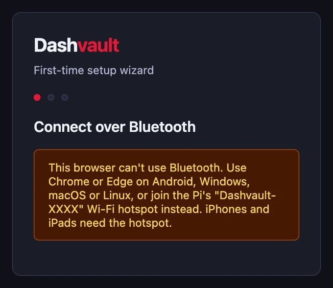

## Before you start

- A **Raspberry Pi** from the [hardware table](../README.md#hardware). The Radxa Zero 3 and other boards [install differently](../README.md#radxa-and-other-boards).
- A **microSD card** of 64 GB or more, ideally a high-endurance one.
- A **USB charger** for the first boot. You plug into the car at the end.
- **A phone or computer with Bluetooth**, within a few metres of the Pi.
- **Your Wi-Fi name and password.** The network needs internet access during setup.
- A router using **WPA2 or mixed WPA2/WPA3**:
  - WPA3-only networks do not work on the Pi Zero W or Pi 400.
  - The Pi Zero W cannot join routers that offer PSK-SHA256.
  - The Pi Zero W only supports 2.4 GHz.
  - See the [measured results](hardware-testing.md#measured-results).

> [!WARNING]
> The Pi's Bluetooth setup service needs no pairing. Until setup is done, anyone in radio range can read what is sent, including your Wi-Fi password, and could configure the Pi before you do. Do this at home and finish promptly. To avoid this completely, [use a configuration file](../README.md#set-up-with-a-file) instead.

## 1. Write the image to the card

1. Download the image from the [latest release](https://github.com/pgodlews/dashvault/releases/latest).
2. Open [Raspberry Pi Imager](https://www.raspberrypi.com/software/).
3. For the operating system, scroll to the bottom of the list and choose **Use custom**, then pick the image.
4. Choose your card and write it.
5. If Imager offers to apply customisation settings, say **no**. Dashvault does not use them.

## 2. Open the setup page

Open **<https://pgodlews.github.io/dashvault/setup/>** in Chrome or Edge **before you power on the Pi**, because the Bluetooth window on Pi Zero boards is short.

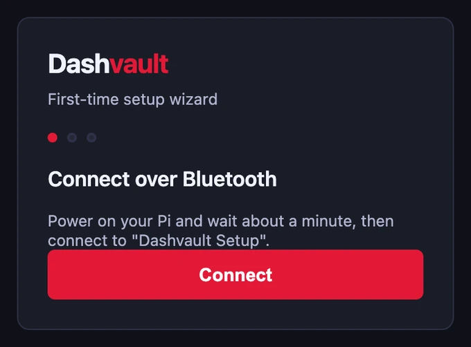

## 3. Power on and connect

Put the card in the Pi, plug it into a USB charger and **wait about a minute**. Then tap **Connect**. Your browser shows a list of nearby devices. Choose **Dashvault Setup** and confirm. There is no pairing code.

> [!IMPORTANT]
> **Pi Zero W and Zero 2 W** have one radio, so they advertise Bluetooth for only **90 seconds**. Once you are connected it stays on while you fill in the page, for up to 15 minutes. If you miss the window, the Pi switches to its `Dashvault-XXXX` hotspot for 10 minutes. Either [carry on over the hotspot](setup-wifi-hotspot.md#3-join-the-dashvault-xxxx-network), or wait for Bluetooth to come back after it. Other boards offer Bluetooth and the hotspot at the same time.

## 4. Choose your Wi-Fi

The page reads the list of networks from the Pi, strongest first. It shows as many as fit in one Bluetooth message, so a busy area may not list them all.

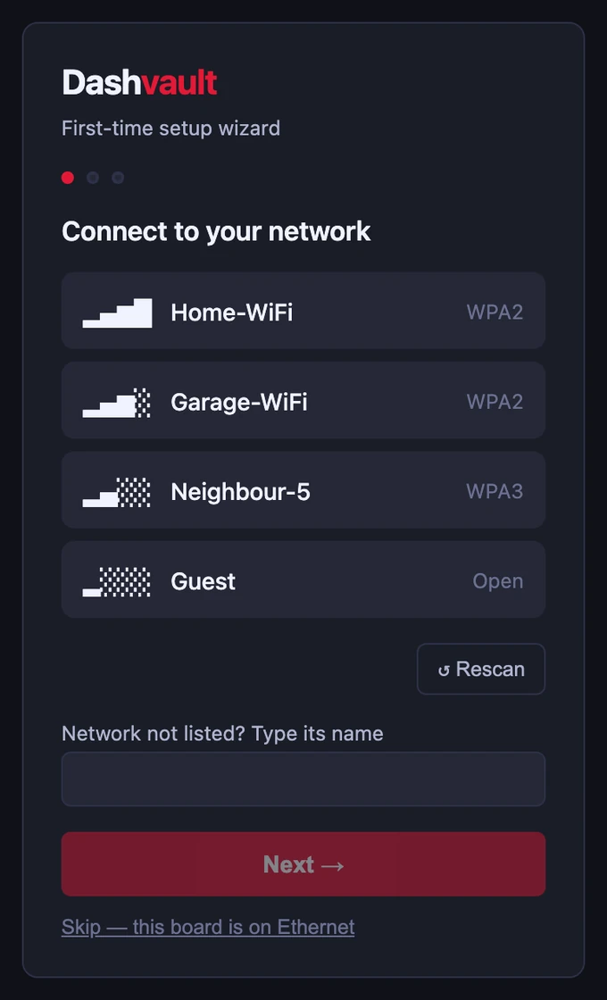

Tap yours and enter its password. If it isn't listed, type its name in the box under the list.

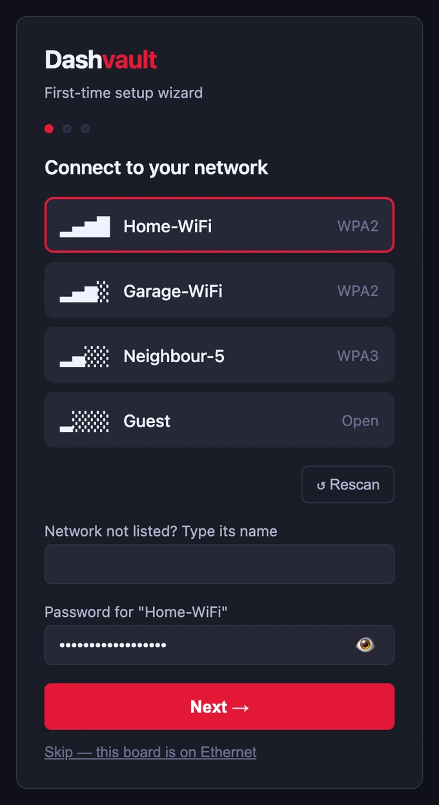

Tap **Next**.

## 5. Choose storage and create your login

The simplest choice is **On this Pi for now, add backup later**. Clips stay on the card, and the oldest age out as space is needed, until you add an archive in the web app under Settings → Archive storage. SMB and NFS can be set up there. Cloud storage needs an rclone remote configured on the Pi over SSH first.

Then create the login for the web app. The password must be at least 8 characters, and it also replaces the default password of the Pi's `pi` account, so keep it somewhere safe.

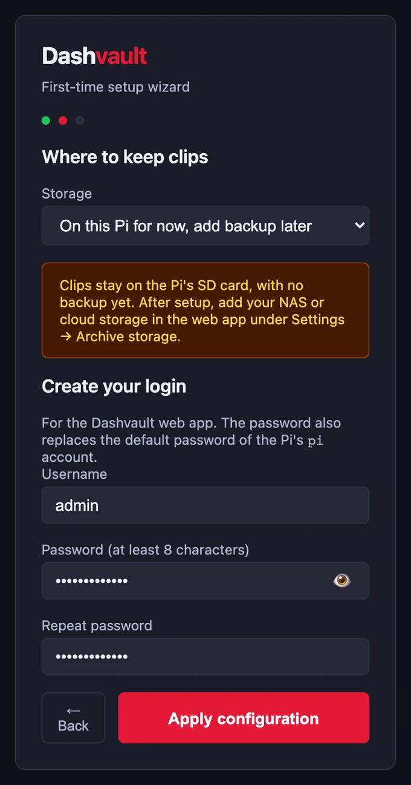

Tap **Apply configuration**.

## 6. Settings saved

The Pi confirms that it has your details, then restarts. The Bluetooth connection ends here.

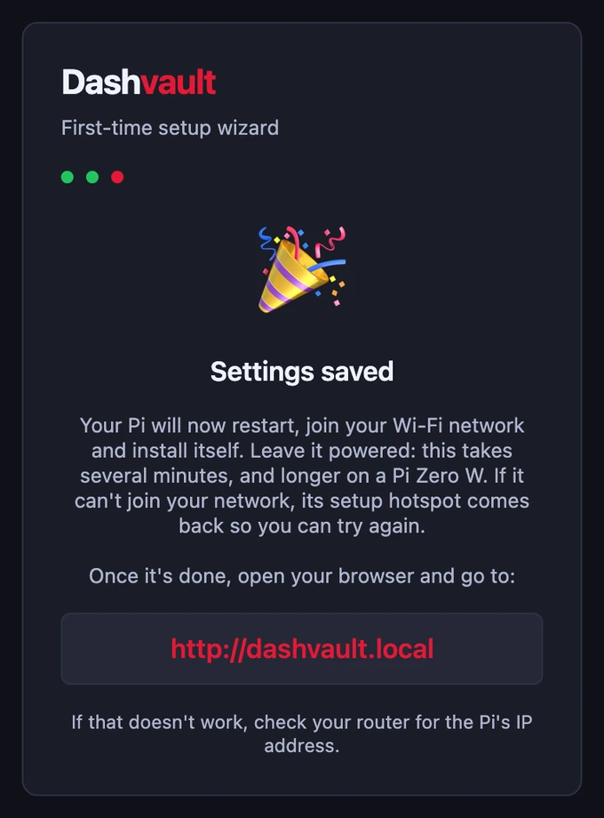

## 7. Follow the install

Make sure your phone or computer is on the **same Wi-Fi network you just chose**, then open **`http://dashvault.local`**. If that doesn't load, find the Pi's IP address in your router and open that instead. It can take a few minutes to appear.

The page shows each install step and updates by itself. Leave the Pi powered. This takes several minutes, and 20 to 40 on a Pi Zero W. The Pi restarts along the way, and the page keeps up.

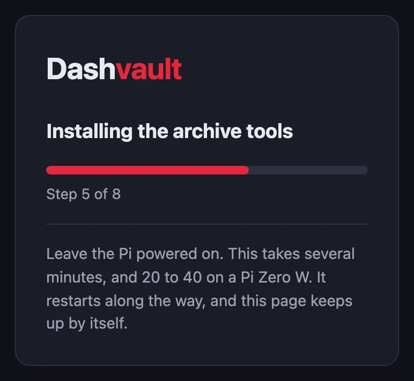

## 8. The final restart

Near the end the page says **Finishing the install**, then **Final restart**. Leave the Pi on. The restart takes a minute or two, and up to about four on a Pi Zero.

<table>
  <tr>
    <td>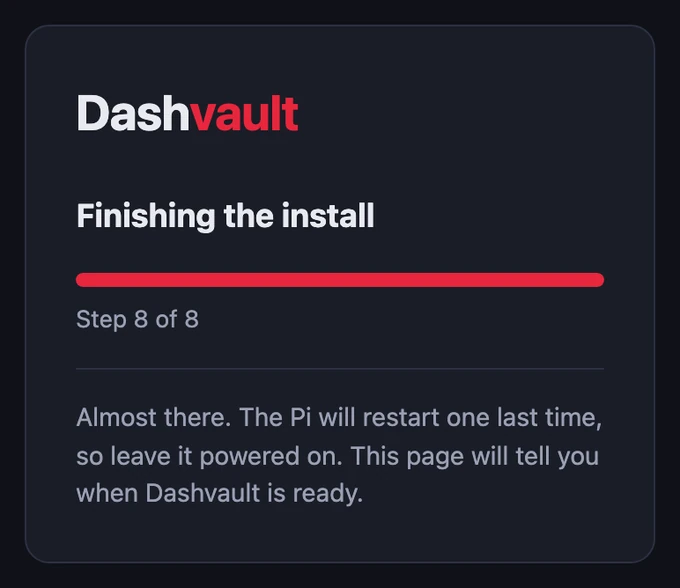</td>
    <td>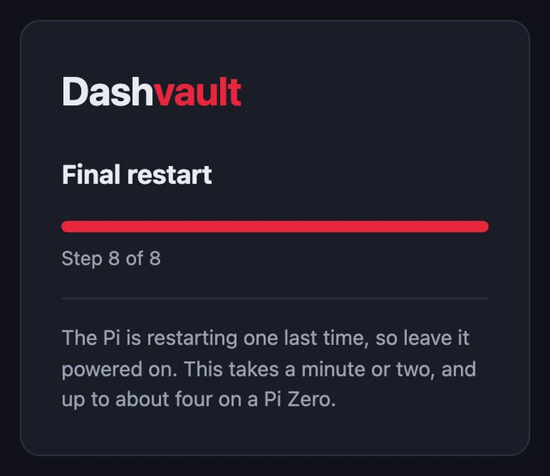</td>
  </tr>
</table>

If the Pi has not come back after about six minutes, the page tells you to unplug it for a few seconds, plug it back in, and give it a few minutes.

## 9. First sign-in

When the page says **Dashvault is ready**, tap **Open Dashvault**.

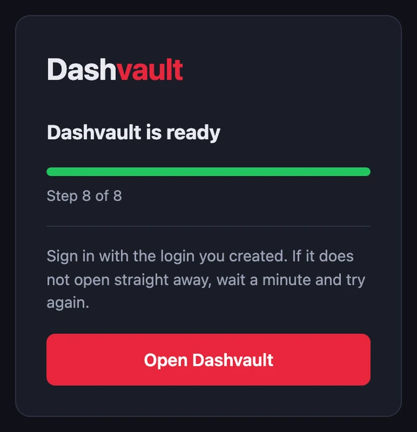

Your browser asks for a username and password. Enter the login you created in step 5, and the dashboard opens.

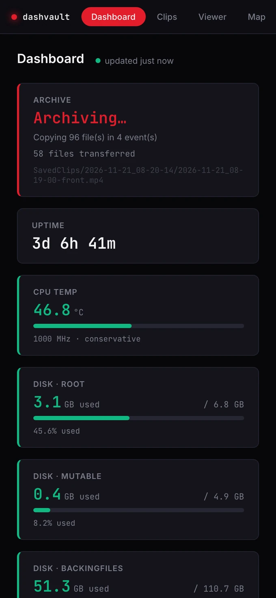

Ten wrong passwords from one address lock sign-in for five minutes.

## 10. Plug it into the car

Connect the Pi's USB **data** port to the car's USB data port with a data cable. On recent cars that is the glovebox port. Check that the dashcam icon appears on the car's screen.

If you kept clips on the Pi, add your archive when you're ready under **Settings → Archive storage**.

## If something goes wrong

### Wrong Wi-Fi password

If the Pi can't join your network, it forgets the details and goes back to setup. **The Bluetooth page cannot show you why**, so the sign is that `http://dashvault.local` never appears and a `Dashvault-XXXX` network shows up in your Wi-Fi list.

The quickest way to see the reason and fix it is to join that hotspot. Its page shows the error in a red banner:

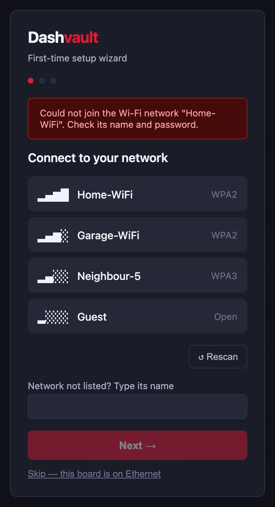

Or reload the Bluetooth page and connect again. On Pi Zero boards, Bluetooth is available in the first 90 seconds of each setup cycle, so you may need to wait for it. Either way, enter the correct password and your login again, since the earlier details were discarded. If the password is right and it still fails, check the [router requirements](#before-you-start).

### "Dashvault Setup" isn't in the device list

- Wait a full minute after powering on, then try again.
- On a Pi Zero, you may have missed the 90-second window. Look for the `Dashvault-XXXX` hotspot and [use that](setup-wifi-hotspot.md#3-join-the-dashvault-xxxx-network).
- Check that Bluetooth is on and that your browser is allowed to use it in your system's privacy settings.
- If you put a configuration file on the card, Bluetooth setup does not start, by design.

### Setup stopped

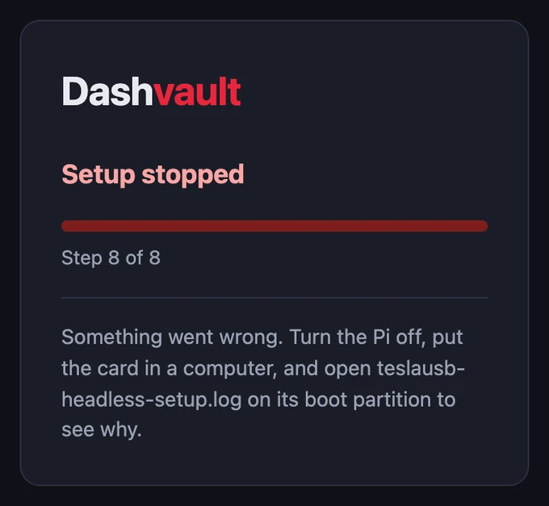

Turn the Pi off, put the card in a computer, and open `teslausb-headless-setup.log` on its boot partition. The [setup guide](../doc/OneStepSetup.md) covers troubleshooting.

### `dashvault.local` doesn't open

Check that your device is on the same Wi-Fi as the Pi. Some devices and networks don't resolve `.local` names, so look up the Pi's IP address in your router and use that.
