# Set up Dashvault over the Wi-Fi hotspot

This is the route that works from any phone or laptop, including an iPhone. You write the image to a card, join a temporary Wi-Fi network from the Pi, fill in one page, and wait for the Pi to install itself.

Most of the time is waiting: the install takes several minutes, and 20 to 40 on a Pi Zero W.

Prefer Bluetooth? See the [Bluetooth guide](setup-bluetooth.md). Screenshots in this guide show the real setup pages with demo data.

## Before you start

- A **Raspberry Pi** from the [hardware table](../README.md#hardware). The Radxa Zero 3 and other boards [install differently](../README.md#radxa-and-other-boards).
- A **microSD card** of 64 GB or more, ideally a high-endurance one.
- A **USB charger** for the first boot. You plug into the car at the end.
- **Your Wi-Fi name and password.** The network needs internet access during setup.
- A router using **WPA2 or mixed WPA2/WPA3**:
  - WPA3-only networks do not work on the Pi Zero W or Pi 400.
  - The Pi Zero W cannot join routers that offer PSK-SHA256.
  - The Pi Zero W only supports 2.4 GHz.
  - See the [measured results](hardware-testing.md#measured-results).

> [!WARNING]
> The setup hotspot is open and unencrypted. Whatever you type on it, including your Wi-Fi password, travels in the clear, and anyone nearby could reach the page before you do. Do this at home and finish promptly. To avoid the hotspot completely, [use a configuration file](../README.md#set-up-with-a-file) instead.

## 1. Write the image to the card

1. Download the image from the [latest release](https://github.com/pgodlews/dashvault/releases/latest).
2. Open [Raspberry Pi Imager](https://www.raspberrypi.com/software/).
3. For the operating system, scroll to the bottom of the list and choose **Use custom**, then pick the image.
4. Choose your card and write it.
5. If Imager offers to apply customisation settings, say **no**. Dashvault does not use them.

## 2. Power on the Pi

Put the card in the Pi and plug it into a USB charger. Leave it for **about two minutes**, or three on a Pi Zero W.

Pi Zero boards have one radio, so they offer Bluetooth setup for the first 90 seconds and then switch to the hotspot. Other boards offer both at once.

## 3. Join the `Dashvault-XXXX` network

On your phone or laptop, open the Wi-Fi list and join **`Dashvault-XXXX`**. The last four characters are different on every Pi.

The setup page opens by itself. If it doesn't, open a browser and go to **`http://192.168.4.1`**. Your device may warn that this network has no internet. That is expected, so stay connected.

The hotspot stays up for 10 minutes at a time. If it disappears before you finish, it comes back shortly.

## 4. Choose your Wi-Fi

The page lists the networks the Pi can see, strongest first.

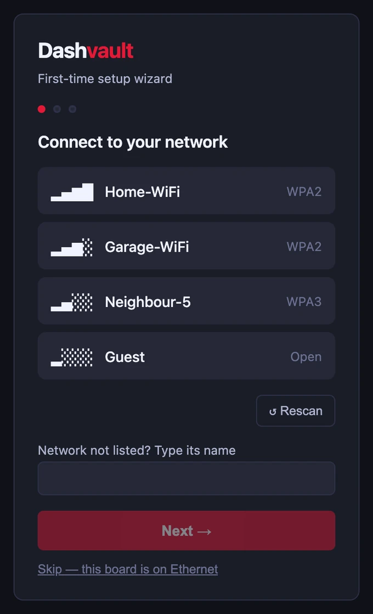

Tap yours and enter its password. If it isn't listed, type its name in the box under the list. On a board connected by Ethernet, choose **Skip**.

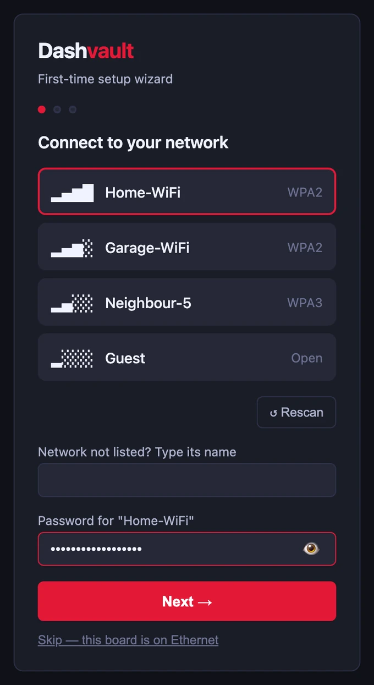

Tap **Next**.

## 5. Choose storage and create your login

The simplest choice is **On this Pi for now, add backup later**. Clips stay on the card, and the oldest age out as space is needed, until you add an archive in the web app under Settings → Archive storage. SMB and NFS can be set up there. Cloud storage needs an rclone remote configured on the Pi over SSH first.

Then create the login for the web app. The password must be at least 8 characters, and it also replaces the default password of the Pi's `pi` account, so keep it somewhere safe.

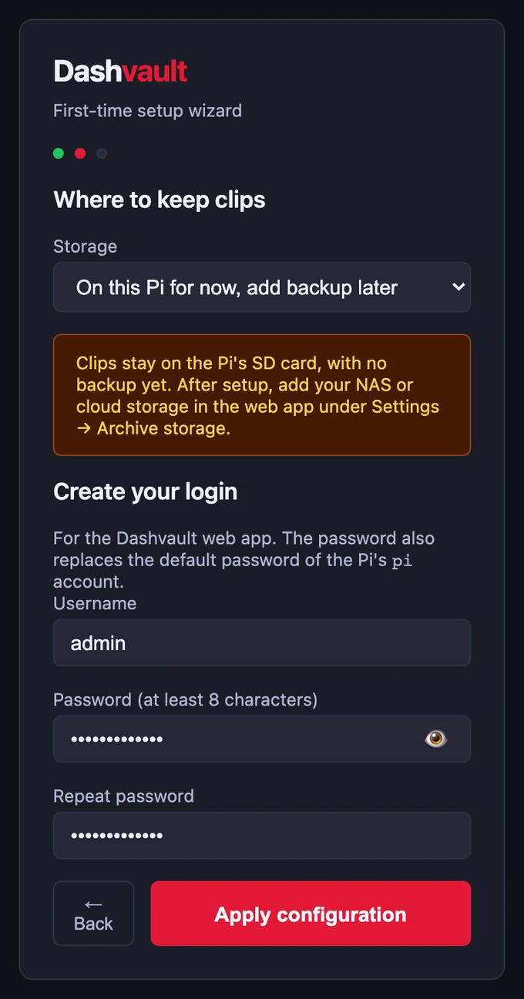

Connecting a NAS now instead

 

Choose SMB, NFS, rclone or rsync and fill in the fields that appear. For an SMB share you need the host, the share name and, if the share requires them, a username and password. For rclone, see the [rclone guide](../doc/SetupRClone.md) first.

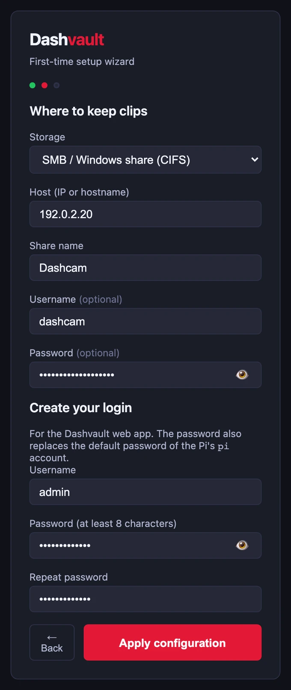

Tap **Apply configuration**.

## 6. Settings saved

The Pi confirms that it has your details, then restarts.

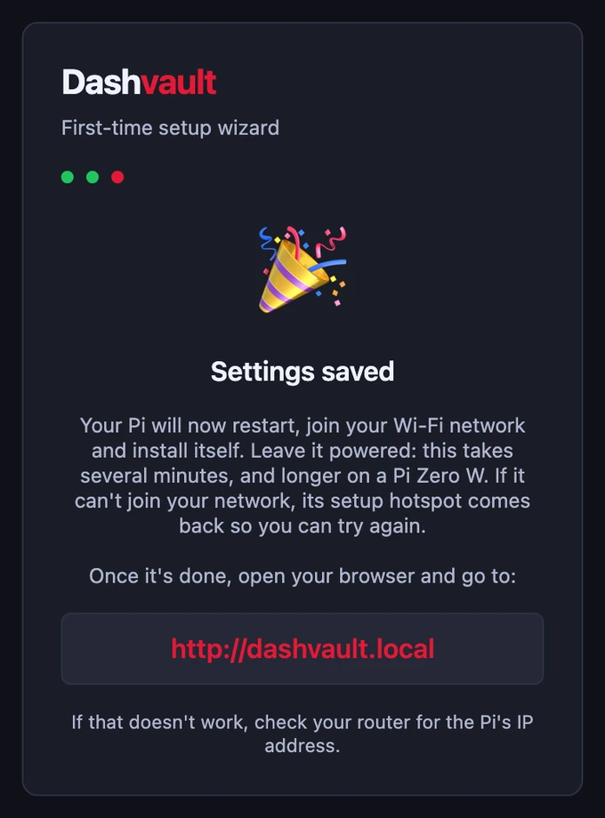

The hotspot goes away now. **Reconnect your phone or laptop to your home Wi-Fi.**

## 7. Follow the install

On your home Wi-Fi, open **`http://dashvault.local`**. If that doesn't load, find the Pi's IP address in your router and open that instead. It can take a few minutes to appear.

The page shows each install step and updates by itself. Leave the Pi powered. This takes several minutes, and 20 to 40 on a Pi Zero W. The Pi restarts along the way, and the page keeps up.

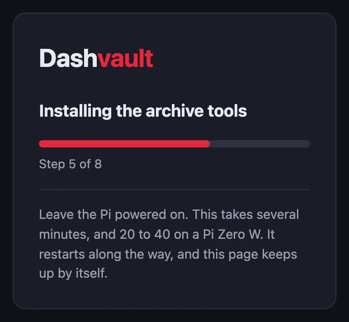

## 8. The final restart

Near the end the page says **Finishing the install**, then **Final restart**. Leave the Pi on. The restart takes a minute or two, and up to about four on a Pi Zero.

<table>
  <tr>
    <td>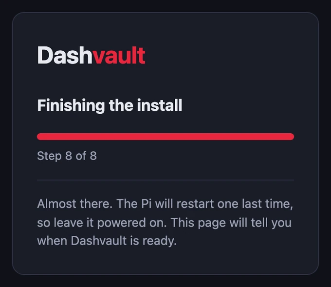</td>
    <td>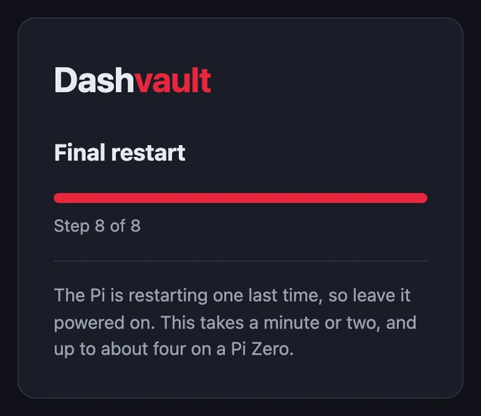</td>
  </tr>
</table>

If the Pi has not come back after about six minutes, the page tells you to unplug it for a few seconds, plug it back in, and give it a few minutes.

## 9. First sign-in

When the page says **Dashvault is ready**, tap **Open Dashvault**.

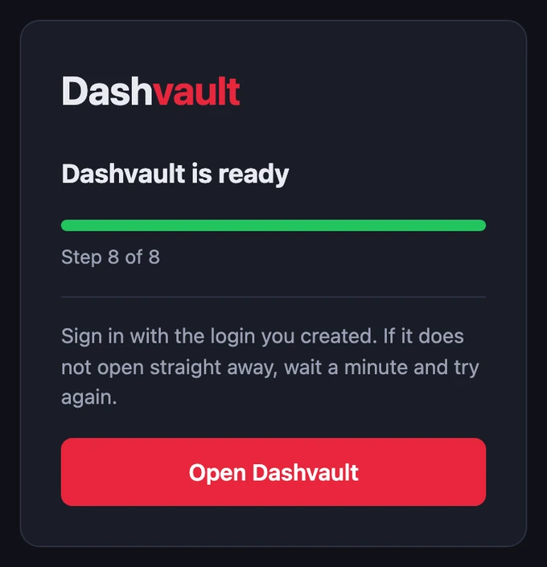

Your browser asks for a username and password. Enter the login you created in step 5, and the dashboard opens.

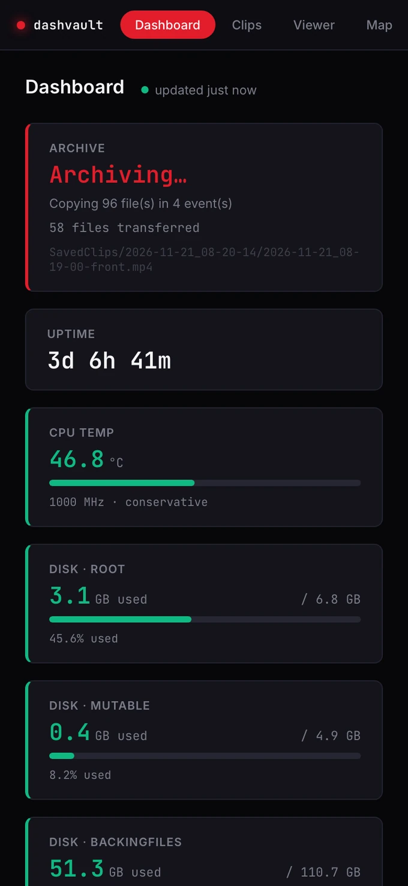

Ten wrong passwords from one address lock sign-in for five minutes.

## 10. Plug it into the car

Connect the Pi's USB **data** port to the car's USB data port with a data cable. On recent cars that is the glovebox port. Check that the dashcam icon appears on the car's screen.

If you kept clips on the Pi, add your archive when you're ready under **Settings → Archive storage**.

## If something goes wrong

### Wrong Wi-Fi password

If the Pi can't join your network, it forgets the details and brings the setup hotspot back. **Join `Dashvault-XXXX` again.** The page tells you what happened:

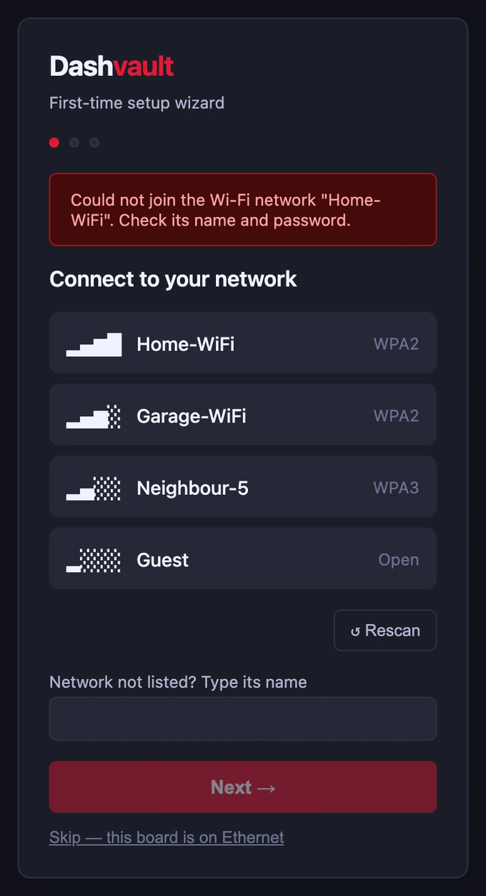

Choose the network, enter the correct password and go through the page again, including your login, since the earlier details were discarded. If the password is right and it still fails, check the [router requirements](#before-you-start). A WPA3-only network is the most likely cause on a Pi Zero W or Pi 400.

### Setup stopped

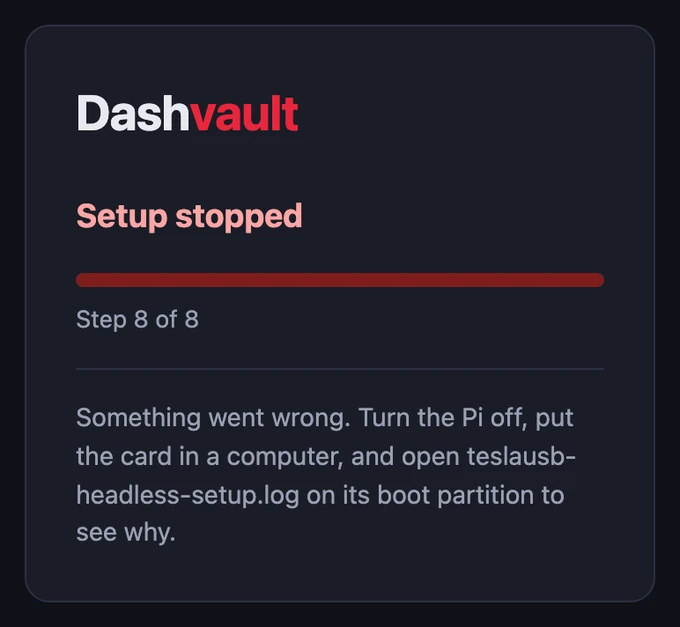

Turn the Pi off, put the card in a computer, and open `teslausb-headless-setup.log` on its boot partition. The [setup guide](../doc/OneStepSetup.md) covers troubleshooting.

### `dashvault.local` doesn't open

Check that your device is back on your home Wi-Fi, not on the hotspot. Some devices and networks don't resolve `.local` names, so look up the Pi's IP address in your router and use that.

### The hotspot never appears

Give it three minutes, and check the charger and that the card is fully seated. If you put a configuration file on the card, the hotspot does not start, by design.
