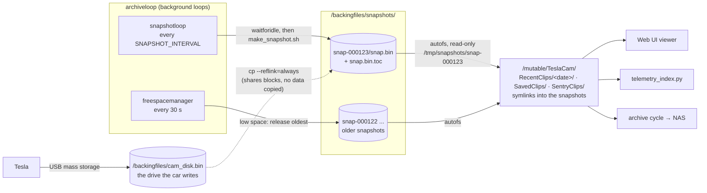
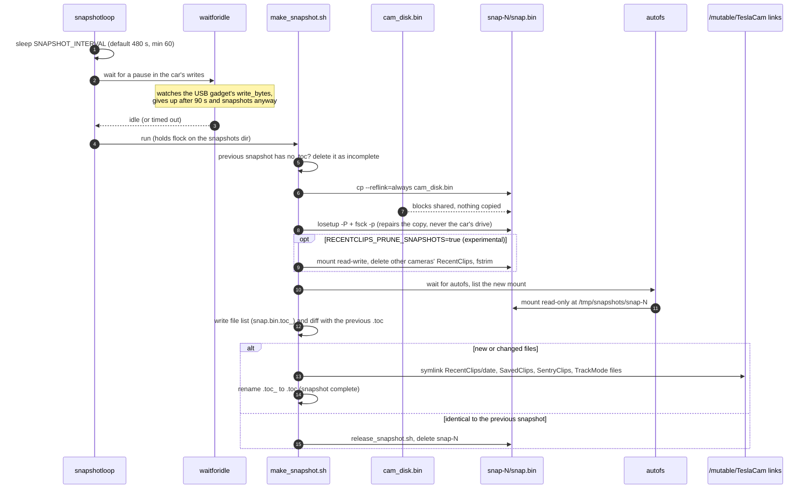
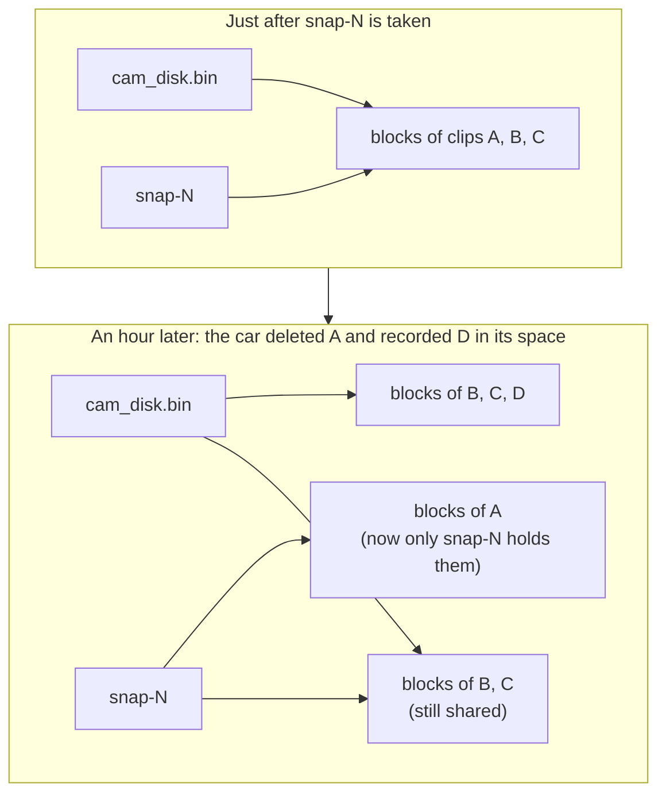
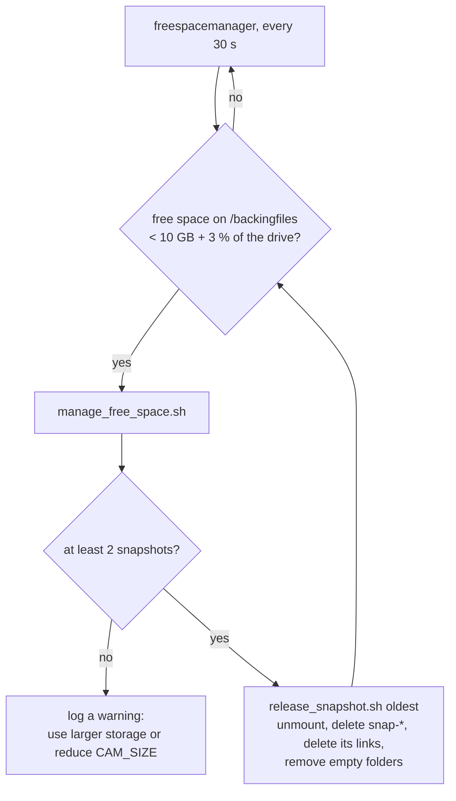
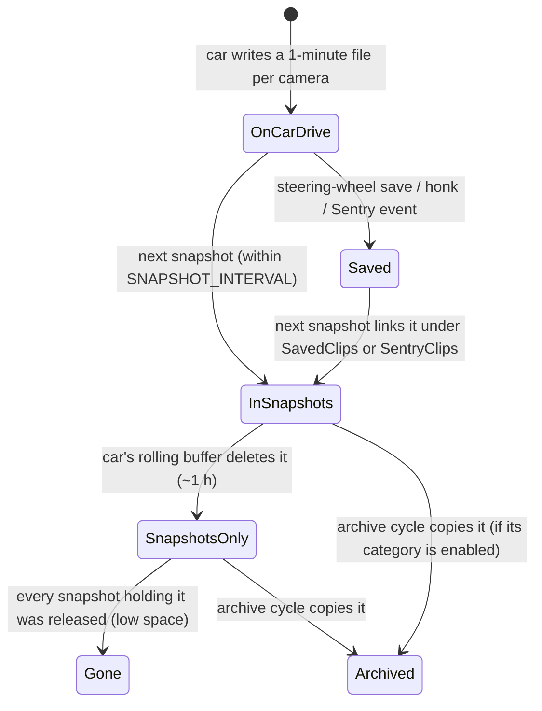
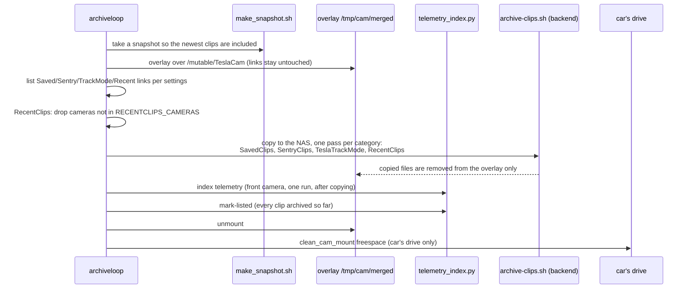
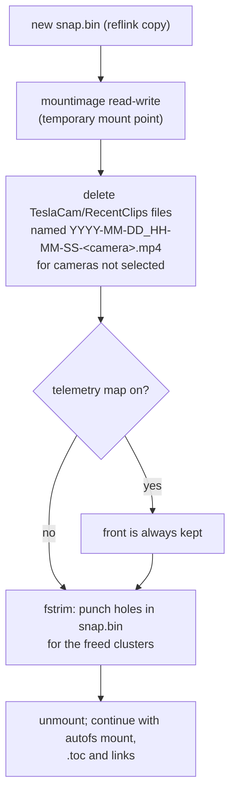

# Snapshots: how RecentClips are kept on the Pi

The car records to `cam_disk.bin`, a FAT/exFAT image the Pi presents as a USB
drive. The car keeps only its own rolling buffer of RecentClips (about the last
hour) and reuses the space after that. Snapshots are how the Pi keeps more:
every `SNAPSHOT_INTERVAL` it takes a copy-on-write copy of the whole image, so
clips the car has since deleted are still readable from older snapshots until
free space runs low.

Code: `run/archiveloop` (`snapshotloop`, `freespacemanager`),
`run/make_snapshot.sh`, `run/waitforidle`, `run/auto.teslausb`,
`run/manage_free_space.sh`, `run/release_snapshot.sh`. Paths come from
`run/lib/paths.sh`.

## The pieces

- **Snapshot image:** `snap.bin` is a reflink copy of `cam_disk.bin`. Taking one
  copies no video; the two files share every block until the car overwrites one.
- **Mounting:** snapshots are mounted read-only on demand by autofs
  (`/etc/auto.master.d/teslausb.autofs` → `run/auto.teslausb`), using the
  filesystem type and partition offset from `run/mountoptsforimage`.
- **Links:** `/mutable/TeslaCam` holds only symlinks. Each clip links to the
  newest snapshot that has it (`ln -sf` replaces older links), so one tree shows
  everything still on the Pi, regardless of which snapshot holds it.

## Taking a snapshot

Snapshots are also taken once at boot (`make_snapshot.sh nofsck`, after
`fix_errors_in_images` already checked the image) and right before each archive
cycle, so the archive sees the latest clips.

A snapshot only counts once its `.toc` exists. If power is lost anywhere before
that, the next run deletes the half-made snapshot; the clips are still in the
previous snapshots and on the car's drive.

## Why snapshots cost little space

A snapshot only uses space for blocks the car has overwritten since. The space
in use is therefore about "how much video the car has recorded and deleted since
the oldest snapshot", which is what `freespacemanager` keeps in check.

## Free space

The oldest snapshot is deleted whole. How far back RecentClips go therefore
depends on storage size and how much the car records per hour.

## A clip's life

- **Saving with the steering-wheel button** happens on the car's drive: the car
  puts the last minutes of RecentClips into `SavedClips/<time>/`. The next
  snapshot sees that folder with every camera. Nothing the Pi does to snapshots
  changes the car's drive.
- **After archiving**, `clean_cam_mount freespace` may delete the oldest files
  from the car's drive to keep about 20 GB free for the car. Snapshots taken
  before that still hold them.

## The archive cycle and snapshots

Archiving reads from snapshots, never from the drive the car is writing, so the
car keeps recording throughout.

## Experimental: pruning cameras from snapshots

With `RECENTCLIPS_PRUNE_SNAPSHOTS=true` and a camera list in
`RECENTCLIPS_CAMERAS` (Settings → Archive → RecentClips cameras), every new
snapshot is pruned right after `fsck`, before it is mounted read-only or linked:

- **What it changes:** once the car deletes a clip from its drive, only the kept
  cameras' blocks remain in snapshots, so the same space holds more minutes
  (about 4× with front only on a 4-camera car). Older, unpruned snapshots keep
  every camera until they age out.
- **What it never touches:** the car's drive, `SavedClips`, `SentryClips`,
  `TeslaTrackMode`, symlinks, files whose names are not dashcam clips, and
  cameras the code does not know.
- **Failure handling:** if the read-write mount fails, the snapshot is kept
  unpruned. If `fstrim` fails, the space is released when the snapshot is
  deleted. A power cut leaves the snapshot without `.toc`, so it is discarded.
- **Cost:** a few hundred deletions per snapshot plus one `fstrim`; the log line
  `pruning: removed N RecentClips file(s) ... in Xs` records how long it took.
